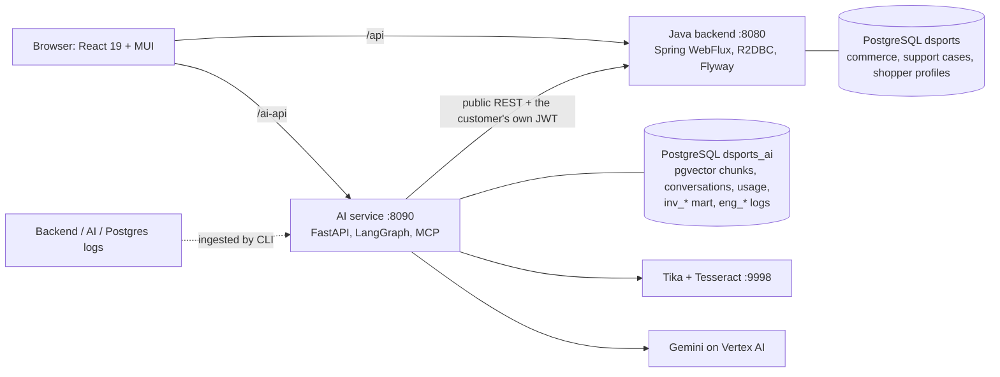
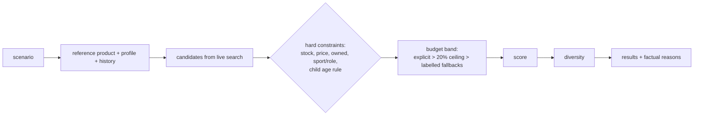
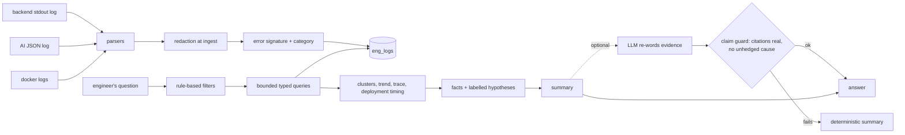
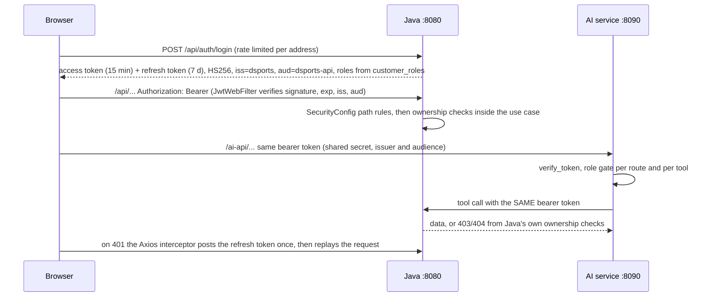
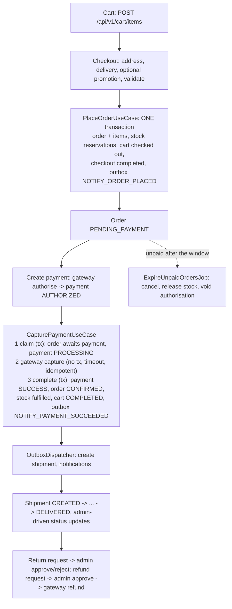
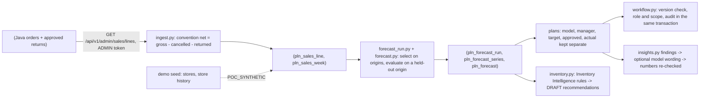
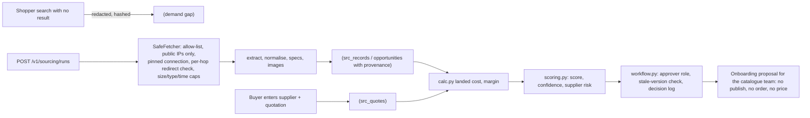

# DSports-AI architecture overview

One-page map of what exists. Decisions: ADR-009 (Python AI service), ADR-010 (Inventory Intelligence), ADR-011 (support resolution), ADR-012 (profiles and recommendations), ADR-013 (Engineering AI), ADR-014 (Product & Supplier Intelligence), ADR-015 and ADR-016 (planning and AI-assisted analysis) in [adr/](adr/). Per-service detail: [services/](services/README.md).

## 1. Service boundaries and data ownership



Java is authoritative for catalogue, price, stock, cart, orders, payments, refunds, shipments, returns, support cases, profiles/preferences and all authorization. The AI service owns orchestration, retrieval, explanation, evaluation, usage records, the derived inventory mart and the log store. It never stores or invents a commerce fact; it forwards the caller's token so Java's ownership checks (403/404) are the real enforcement.

## 2. Customer AI request flow

```mermaid
sequenceDiagram
  participant U as Customer
  participant A as AI service
  participant R as Router (rules → cheap LLM)
  participant T as Tool registry
  participant J as Java API
  U->>A: POST /v1/chat (JWT)
  A->>R: classify (Tier 0 rules first; LLM only if unsure)
  R->>T: typed tool call (READ)
  T->>J: GET with the customer's JWT
  J-->>T: authoritative data (or 403/404)
  T-->>A: result (trimmed, untrusted text fenced)
  A-->>U: structured answer; a WRITE returns a proposal + single-use confirmation token
  U->>A: POST /v1/confirm (token bound to user, tool, args hash)
  A->>J: write with Idempotency-Key
```

Writes (return, reorder, support case/message/escalation/reopen) always go through a proposal, an explicit confirmation, an idempotency key and an audit row. ADMIN-only tools (inventory, engineering) are refused by the registry itself for every caller, REST or MCP.

## 3. Recommendation pipeline (deterministic, no model call)



## 4. Inventory Intelligence

Live catalogue + POC reference data + **POC SYNTHETIC** history (`data_source` on every row) → data quality → time-based backtest (last 90 days held out) vs baselines → persisted forecasts, assessments (stock-out risk, replenishment, overstock, events, scenarios) → deterministic tools. The LLM only understands questions and explains numbers; a grounding check rejects any number not present in tool output. ADMIN only; decision support, nothing is executed.

## 5. Engineering AI



ADMIN only (REST and tools); instruction-like log text is withheld; synthetic records are labelled; denials and investigations are audited without log content.

## 6. Failure handling and observability

* LLM failure: circuit breaker, Tier-0 flows still work, structured `ai_unavailable`; recommendations and Engineering AI summaries are deterministic and unaffected.
* Downstream failure: tools return typed errors; the assistant never reports a write as done unless Java confirmed it.
* Correlation: `X-Correlation-Id` is propagated Java ↔ AI and appears in both logs (the basis of Engineering AI tracing). Usage (tokens, latency, cost *estimate*) is recorded per call; metrics at `/metrics` (AI) and Actuator (Java).
* Not present: central log platform, tracing backend, alerting, frontend log collection (see STATUS.md).

## 7. Authentication and authorization flow



The shared HS256 secret, `localStorage` token storage and 15-minute role lifetime are known risks (R1 to R3 in [security/THREAT-MODEL.md](security/THREAT-MODEL.md)). Roles are never accepted from request headers or bodies.

## 8. Commerce transaction flow (real code path)



The gateway is `MockPaymentGateway`. Order, payment, shipment and return status machines are in the enums `OrderStatus`, `PaymentStatus`, `ShipmentStatus`, `ReturnStatus`. A paid order can only end through fulfilment or a refund.

## 9. Forecasting and planning flow



No step writes to the Java database, orders, moves stock, publishes or prices.

## 10. Product discovery and supplier sourcing flow



## 11. Timeouts, retries and limits (from code and settings)

| Where | Value |
|---|---|
| Payment gateway call (Java) | `app.payment.gateway-timeout` default 10 s; capture is idempotent and safe to retry |
| Outbox (Java) | poll 1 s, batch 20, lease 5 min, max 8 attempts, `FOR UPDATE SKIP LOCKED` |
| Unpaid order expiry (Java) | check every 60 s |
| Rate limits (Java, in memory) | auth routes 20/min per address; case creation 10/min and case messages 30/min per user |
| AI call to Java | `AI_TIMEOUT_S` default 30 s; no automatic retry |
| Model calls | one retry; circuit breaker opens after `AI_BREAKER_FAILURES` (3) and cools down `AI_BREAKER_COOLDOWN_S` (30 s) |
| One chat request | `AI_REQUEST_TIMEOUT_S` 90 s, `AI_MAX_ITERATIONS` 12, `AI_MAX_TOOL_CALLS` 8, `AI_REQUEST_TOKEN_BUDGET` 8000 |
| Confirmation token | 300 s, single use |
| External research fetch | `SOURCING_TIMEOUT_S` 10 s, size cap `SOURCING_MAX_BYTES`, `SOURCING_RUNS_PER_HOUR` 6 |
| Planning analysis | `PLANNING_ANALYSES_PER_MIN` 6 per person |
