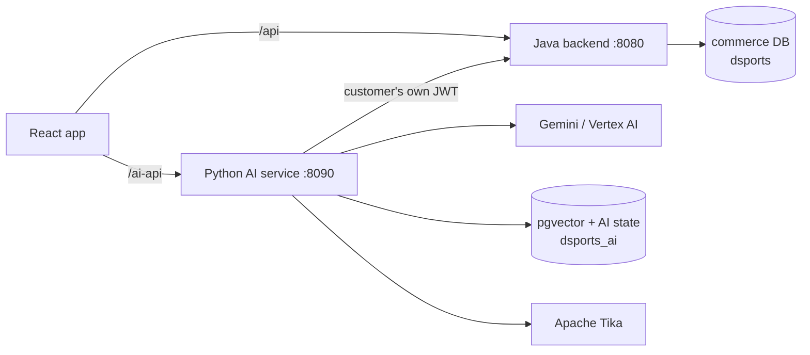

# DSports AI: master learning guide

**Share this file first.** It orients a reader who has never seen the repository and links to the detailed documents. A single self-contained overview is in [DSports-AI-Complete-Learning-Guide.md](DSports-AI-Complete-Learning-Guide.md); what was and was not verified is in [DOCUMENTATION-COVERAGE.md](DOCUMENTATION-COVERAGE.md).

Status labels used everywhere: `IMPLEMENTED`, `TESTED`, `VERIFIED` (recorded execution evidence), `PARTIALLY IMPLEMENTED`, `PLANNED`, `NOT IMPLEMENTED`, `SYNTHETIC / POC DATA`, `UNKNOWN`. Source references: `symbol @ path:start-end`.

## 1. Executive overview

DSports AI is a proof of concept that adds AI to an existing sports-commerce platform (Java Spring Boot backend, React frontend) through a separate Python/FastAPI service. Three phases are implemented:

1. **Customer AI commerce:** natural-language product discovery, comparison and advice, cited product/policy answers (RAG), order/payment/refund lookups, return eligibility and confirmed return requests, reorder-to-cart, recommendations.
2. **Inventory Intelligence (internal, ADMIN):** deterministic forecasting, stock-out risk, replenishment, overstock/slow-moving/aging, event impact, promotion what-ifs and clearance; dashboard and copilot; **decision support only**, on **synthetic data**.
3. **Customer Support and Case Resolution:** complaint investigation from the customer's own records, policy retrieval, deterministic decisions, confirmed creation of real persisted support cases in Java, customer and staff UIs.

The central design rule: **the model understands and explains; code and live systems decide and verify.** Java is the source of truth for every price, stock level, order, payment, refund, shipment, return and case.

## 2. Business problem and objectives
See [01-business-context.md](01-business-context.md). Objectives: help customers find and manage purchases, help the business plan stock, help customers get complaints resolved, and do so with verifiable safety. **No business impact has been measured**; value statements are hypotheses.

## 3. Technology stack

| Layer | Technology |
|---|---|
| Frontend | React 19, TypeScript, Vite, MUI 6, React Router 7, Zustand, TanStack Query, Axios |
| Commerce backend | Java 21, Spring Boot 3.4 WebFlux, R2DBC, Flyway (V1-V44), Spring Security (JWT), springdoc OpenAPI, Testcontainers |
| AI service | Python 3.13, uv, FastAPI, LangGraph, official MCP SDK, Pydantic, httpx, asyncpg, numpy |
| LLM | Gemini on Google Vertex AI: `gemini-2.5-flash-lite` (Tier 1), `gemini-2.5-flash` (Tier 2), `text-embedding-005` (768-d) |
| Data | PostgreSQL 16 + pgvector (`dsports` owned by Java, `dsports_ai` owned by Python), Apache Tika + Tesseract OCR |
| Validation | pytest, Maven/Surefire, Playwright (Node), `e2e/validate-all.sh`, custom evaluation harnesses |
| DevOps | Docker Compose (Postgres, Tika, AI service profile); GitHub Actions and Cloud Run are `PLANNED` (no workflow files exist) |

## 4. High-level architecture and end-to-end data flow

One assistant turn: browser -> AI service (JWT verified) -> `guard_in` -> router (rules, then cheap model) -> domain subgraph -> typed tools -> Java REST with the same JWT -> deterministic ranking/decision -> optional model explanation -> `guard_out` grounding check -> structured response -> UI components ("verified from DSports" vs "AI explanation"). A state-changing step stops at a confirmation (signed single-use token) and is revalidated and audited before Java executes it. Details: [02](02-system-architecture.md), [05](05-python-ai-service.md), [21](21-end-to-end-journeys.md).

## 5. The detailed documents

| Doc | Topic |
|---|---|
| [01](01-business-context.md) | business context, phases, value, what is real vs POC |
| [02](02-system-architecture.md) | components, topology, boundaries, diagrams |
| [03](03-java-backend.md) | Java modules, security, traced request, support module, migrations |
| [04](04-frontend.md) | React structure, state, assistant UI, support and inventory UIs |
| [05](05-python-ai-service.md) | startup, API, configuration, LangGraph graphs, runtime |
| [06](06-llm-and-prompt-engineering.md) | models, prompts, routing, three traced LLM calls |
| [07](07-rag-and-vector-search.md) | Tika, OCR, chunking, embeddings, pgvector, retrieval, citations |
| [08](08-tools-and-mcp.md) | the 39 tools, confirmation protocol, MCP |
| [09](09-phase1-customer-ai.md) | Phase 1 in depth |
| [10](10-phase2-inventory-intelligence.md) | Phase 2 algorithms and the inventory graph |
| [11](11-phase3-support.md) | Phase 3 case model, workflow, decisions, UI |
| [12](12-database-and-data-model.md) | schemas, ownership, lifecycle |
| [13](13-security-and-reliability.md) | threat table, failure handling |
| [14](14-testing-and-evaluation.md) | tests, evaluations, evidence and its limits |
| [15](15-observability-performance-cost.md) | logs, metrics, cost, troubleshooting |
| [16](16-architecture-decisions.md) | decisions and trade-offs |
| [17](17-source-code-index.md) | file-by-file map |
| [18](18-manager-presentation.md) | manager/engineer presentation guide |
| [19](19-interview-preparation.md) | 110 interview questions grounded in the project |
| [20](20-glossary-and-learning-roadmap.md) | glossary and a 12-session learning plan |
| [21](21-end-to-end-journeys.md) | Journeys A-E traced end to end |
| [Coverage](DOCUMENTATION-COVERAGE.md) | what was inspected, conflicts found, unverified items |

## 6. Most important architectural decisions
Java source of truth + separate Python AI service (ADR-009); deterministic decisions with LLM only for understanding/explanation; typed tool registry with the model unable to call tools; confirmation tokens, revalidation, idempotency and audit for every WRITE; SQL-level isolation of internal documents; synthetic inventory data labelled everywhere (ADR-010); real persisted support cases in Java with escalation separate from status (ADR-011). Trade-offs in [16](16-architecture-decisions.md).

## 7. Current capabilities and limitations (short)
Implemented and verified: everything in section 1 within the stated limits. Not implemented: automatic resolution, photo assessment, carrier/warehouse contact, proof of delivery, exchanges, live agents, notifications, inventory write actions, CI/CD, tracing/dashboards, retention for AI tables. Synthetic/sample: inventory history/costs/suppliers/regions/events, catalogue enrichment, corpora, thresholds; payments are a mock. No SLA or official policy exists. Details: doc 01 section 4, doc 13 section 4.

## 8. Validation summary and evidence locations

| Evidence | Result | Location |
|---|---|---|
| Java module tests / integration | 546 / 36 passed, 0 failed, 0 skipped | `e2e/validation-results/20261012-200629` |
| Python unit | 1084 passed (1083 in the recorded run) | `ai-service/tests` |
| Python integration | 79 passed | `e2e/validation-results/20261012-202456/py-integration.log` |
| Live tests | support 11/11, Vertex 4/4 (re-runs); the recorded `py-live` had 2 quota failures | doc 14 |
| API E2E | 122 passed | `.../api-e2e.log` |
| Phase 1 evaluation | 83/83 (re-run 2026-10-13); held-out first run 24/26 | `ai-service/eval/results/eval-20261013-100909.json`, `holdout-first-run.json` |
| Phase 2 | 35 scenarios pass; dev 56/56; holdout v1 first run 17/20, v2 25/29 (gate missed) | `docs/ai/phase2/14-final-stabilization-report.md` |
| Phase 3 | dev 45/45; held-out first run 15/24; regression 23/24 (H08 genuine miss) | `ai-service/eval/results/`, `SUPPORT-RESULTS-NOTE.md` |
| Browser | support 23 steps passed; inventory 23 steps; customer journeys | `e2e/*.mjs` |
| Consolidated run | PASS 30 / FAIL 6 / SKIP 4; the six failures were individually re-run and passed. **No single clean full run exists.** | `e2e/validation-results/20261012-202456/SUMMARY.md` |

Read doc 14 before quoting any number.

## 9. Suggested learning sequence
Fundamentals first: docs 01, 02, then 20 (glossary). Core mechanics: 05, 08, 06, 07. Phases: 09, 11, 10. Assurance: 13, 14, 15, 16. Then practise with 19 and present with 18. The 12-session plan is in [20](20-glossary-and-learning-roadmap.md).

## 10. Source-code navigation (top ten files)
`ai-service/app/agent/graph.py` (the agent), `app/agent/service.py` (one turn), `app/tools/registry.py` (tool safety), `app/tools/actions.py` + `app/guard/confirmation.py` (confirmed writes), `app/guard/grounding.py` (output verification), `app/rag/retrieval.py` (hybrid search), `app/support/flow.py` + `resolve.py` (support), `app/inventory/forecasting.py` + `planning.py` (Phase 2), `backend/.../SupportCase.java` + `CreateSupportCaseUseCase.java` (cases), `backend/bootstrap/.../SecurityConfig.java` (access rules). Full index: [17](17-source-code-index.md).

## 11. Project glossary (short)
*Source of truth*: the Java service whose data is authoritative. *Tier 0/1/2*: rules / cheap classifier / explainer model. *Typed tool*: validated function in the registry. *WRITE*: a tool that changes data, only after confirmation. *Grounding*: verifying answer claims against tool results. *Case*: a persisted support complaint. *Escalation REQUESTED vs ACCEPTED*: someone was asked vs someone took the case. *POC_SYNTHETIC*: generated data, never real. Full glossary: [20](20-glossary-and-learning-roadmap.md).
