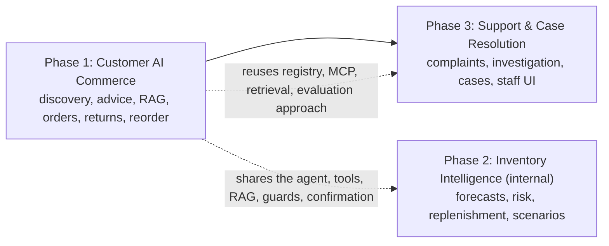

# 01. Business context and requirements

## 1. Why DSports AI exists

DSports is a sports commerce platform (version 1: cricket equipment, now a 134-product multisport demo catalogue). `AGENTS.md` states the aim: not just an e-commerce app, but a **production-style enterprise application built while learning** modern architecture, AI engineering, React, Spring Boot and cloud-native development. The AI layer was added in three phases to explore what an AI-assisted commerce platform needs to be useful **and** safe.

Problems in a conventional storefront that the AI layer addresses (and how far this POC goes):

| Problem | Conventional answer | AI-assisted answer in this POC | Status |
|---|---|---|---|
| Customers can't phrase a search as filters ("lightweight bat for a beginner under 8000") | dropdowns, keyword `ILIKE` | slot extraction + hybrid retrieval + live price/stock + explicit ranking + explanation | IMPLEMENTED, TESTED, VERIFIED (doc 09) |
| Product/policy questions require reading documents | FAQ pages | cited answers from a knowledge base | IMPLEMENTED; sample documents (`SYNTHETIC / POC DATA`) |
| Order/return/refund questions need navigating several pages | order pages | structured answers and confirmed actions | IMPLEMENTED |
| The business must decide what to stock and clear | spreadsheets | forecasts, risk, replenishment, overstock, event and promotion analysis | IMPLEMENTED on **synthetic** data (doc 10) |
| Complaints need investigation and tracking | email/phone | evidence-based investigation + a persisted case + staff console | IMPLEMENTED; no live agent/SLA (doc 11) |

## 2. The three phases and how they relate

* Phase 1 builds the platform pieces: the Python service, typed tools, MCP, RAG, grounding, confirmation tokens, evaluation approach.
* Phase 2 reuses them for an **internal** audience (ADMIN role, `inv_*` data, no WRITE tools, decision support only).
* Phase 3 reuses them again for customers and staff (`support` module in Java; four confirmed WRITE tools for the customer's own case).
The "AI Roadmap" in `AGENTS.md` uses a different numbering (Version 2 AI Product Search ... Version 7 Inventory Prediction); the "Phase 1/2/3" used in this guide are the AI implementation phases (customer commerce, inventory intelligence, support). (`ROADMAP.md` was not inspected for this guide.)

## 3. Use cases and expected business value

| Phase | Use cases | Expected business value (hypothesis, not measured) | Evidence of value |
|---|---|---|---|
| 1 | find/compare products; product knowledge; track orders; check return eligibility and request a return; reorder; recommendations | higher discovery conversion, fewer "where is my order" contacts, lower support load | **None measured.** The repository has no conversion, deflection or satisfaction data. It measures behaviour (accuracy, safety, latency, token cost) |
| 2 | stock-out risk, replenishment quantities and dates, overstock/slow-moving/aging, event readiness, promotion what-ifs, clearance candidates | fewer stock-outs and less dead stock, faster planning | **None on real business data.** Everything is synthetic; accuracy numbers describe the pipeline |
| 3 | investigate delivery/payment/refund/product/return complaints; create and track a case; escalation request; staff console | faster, evidence-attached triage; transparency for customers | **None on real cases.** Behaviour verified by tests and evaluations; "automatically resolved" is always 0 by design |

Do not present these as achieved savings. The honest value statement is: a working, verifiable POC of the architecture and the safety mechanisms, with measured behaviour on test and synthetic data.

## 4. What is fully implemented, partial, synthetic, unsupported

| Area | Status |
|---|---|
| Product discovery, comparison, product Q&A, recommendations | IMPLEMENTED, TESTED, VERIFIED |
| Orders, tracking, payments, refunds (read) | IMPLEMENTED, TESTED, VERIFIED (payments are a mock gateway: money movement is `SYNTHETIC / POC DATA`) |
| Returns (check + confirmed request) and reorder-to-cart | IMPLEMENTED, TESTED, VERIFIED; the assistant cannot approve or pay a refund |
| Inventory forecasting and planning | IMPLEMENTED, TESTED; data `SYNTHETIC / POC DATA`; no real accuracy claim |
| Inventory write actions (price change, purchase order, transfer, promotion launch) | NOT IMPLEMENTED by design (decision support only) |
| Support cases (create, status, message, escalate request, reopen) | IMPLEMENTED, TESTED, VERIFIED |
| Staff actions (assign, notes, replies, status, resolve, analytics) | IMPLEMENTED in Java and the staff UI; NOT tools of the assistant |
| Photo/image assessment of damage | NOT IMPLEMENTED |
| Carrier/warehouse contact, proof of delivery | NOT IMPLEMENTED (DSports has no such data) |
| Live agent handover, email/SMS notifications for cases | NOT IMPLEMENTED |
| Exchanges | NOT IMPLEMENTED in DSports (the assistant says so) |
| Official SLA or policy | none; sample documents and thresholds are labelled demo values |
| Real supplier/cost/region/historical data | not available (`SYNTHETIC / POC DATA`) |
| Production deployment (Cloud Run), CI | `PLANNED` (no pipeline files) |

## 5. Showing the difference between deterministic commerce and AI-assisted reasoning

A good demonstration (details in doc 18):
1. Ask the *deterministic* part: "Show my recent orders" (no model call, Tier 0; instant; every field from Java).
2. Ask the *AI-assisted* part: "lightweight cricket bat for a beginner under 8000" (the model understands/explains; but price, stock and ranking order are computed from live data; the UI separates "VERIFIED FROM DSPORTS" from "AI EXPLANATION").
3. Show the guardrail: edit nothing, ask "Refund me now" or "Show Priya's cases" (refused before any tool or model).
4. Stop the AI service and show the shop, orders and case pages still work.
5. Show that a case number appears only after the Java backend created it ("nobody has taken it yet" until staff accept).

## 6. What problems are genuinely solved vs demonstrated with POC data
* **Genuinely solved (as engineering):** safe use of an LLM over transactional systems: identity propagation, source-of-truth boundaries, grounded answers, confirmed writes with idempotency and audit, internal-document isolation, graceful degradation, evaluation and validation tooling.
* **Demonstrated with POC data:** the business outcomes (conversion, support deflection, inventory savings) and any forecast accuracy; catalogue, corpus, thresholds and policies are samples.
