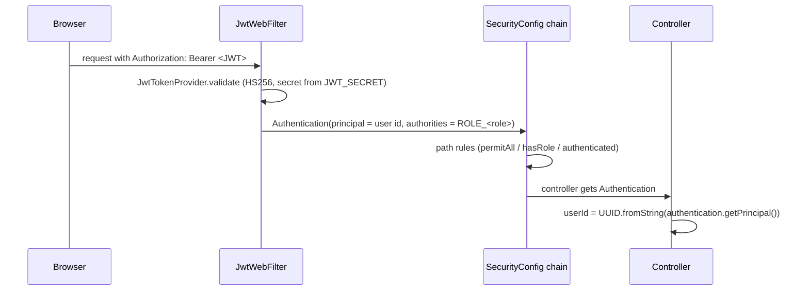

# 03. Java backend code walkthrough

Root: `backend/` (Maven multi-module, Java 21, Spring Boot 3.4.4, WebFlux + Spring Data R2DBC, Flyway, Spring Security, springdoc OpenAPI). Style follows `AGENTS.md`: Clean Architecture / DDD / modular monolith, constructor injection, DTO records, global exception handling, SLF4J, no business logic in controllers.

## 1. Module structure

| Module | Java files | Role | Notes |
|---|---|---|---|
| `shared` | 8 | ports and helpers shared by modules (`TransactionRunner`, `ApiError`, ...) | |
| `identity` | 113 | users, registration/login, JWT, refresh tokens, profile, addresses | roles include `SUPPORT_EXECUTIVE` |
| `catalog` | 139 | sports, categories, brands, products, images, attributes; public + admin controllers | free-text `q` search |
| `pricing` | 52 | prices (admin lifecycle, public read, batch `productIds`) | |
| `inventory` | 64 | stock, reservations, public availability, admin adjustments | |
| `cart` | 47 | cart items | |
| `order` | 106 | checkout (address, delivery, validation) and orders | |
| `payment` | 65 | payments, capture, refunds, refund requests; **mock gateway** | |
| `shipment` | 54 | shipments, tracking events, by-order lookup | |
| `returns` | 22 | return eligibility and requests | added for Phase 1 |
| `review` | 45 | reviews | |
| `wishlist` | 42 | wishlist | |
| `notification` | 43 | notifications | |
| `support` | 27 | Phase 3 support cases | |
| `bootstrap` | 27 | `DSportsApplication`, wiring (`*ModuleConfig`), security, exception handling, outbox, observability | |
| `admin`, `ai`, `billing`, `franchise` | 0 | declared modules with no Java source | `NOT IMPLEMENTED` |

Each business module uses the same layering (verified in `catalog`, `returns`, `support`): `domain/` (aggregates, value objects, policies, domain exceptions), `application/` (ports and use cases), `infrastructure/` (R2DBC entities and repository adapters), `interfaces/` (REST controllers and DTOs). Use cases are plain classes constructed in `bootstrap/.../config/*ModuleConfig.java` (e.g. `SupportModuleConfig @ backend/bootstrap/src/main/java/com/dsports/config/SupportModuleConfig.java:35-88`), so modules depend only on ports they define and `bootstrap` is the only place that wires modules together.

## 2. Application bootstrap and configuration

* Entry: `backend/bootstrap/src/main/java/com/dsports/DSportsApplication.java`.
* Config: `application.yml` (R2DBC pool, Flyway enabled, `app.jwt.secret: ${JWT_SECRET}` with 15 m access and 7 d refresh tokens, Actuator health/info/metrics, springdoc at `/api-docs`, logging pattern with `%X{correlationId}`; lines 21-37, 43-62, 84-92). Profiles `local/dev/test/prod` add database settings. `application-local.yml` contains a development-only fallback for `JWT_SECRET`; treat it as a local convenience, never a production value (`SYNTHETIC / POC` environment).
* Cross-cutting beans: `CorrelationIdFilter` (generates/propagates `X-Correlation-Id`), `ReactiveTransactionRunner` (below), `ObservabilityConfig`, `OpenApiConfig` (bearer scheme).
* Reactive rules from `AGENTS.md`: no blocking calls in reactive flows. Example of the rule being applied: `LoginUseCase` runs BCrypt on `Schedulers.boundedElastic()` (`backend/identity/.../LoginUseCase.java:59-62`).
* Scheduled job: `ExpireUnpaidOrdersJob` runs every 60 s (`@Scheduled(fixedDelayString = "${app.orders.expiry-check-interval:60000}"...)`, `bootstrap/.../jobs/ExpireUnpaidOrdersJob.java:24`) and cancels unpaid orders after `app.orders.payment-window` = `PT30M` by default (`OrderModuleConfig.java:200`). This matters when evaluating over long periods: orders in an evaluation "world" can be cancelled by the backend while a run is in progress (doc 14).

## 3. Authentication and authorization

* `JwtWebFilter.filter @ backend/bootstrap/.../security/JwtWebFilter.java:36-61`: if the header is missing/invalid the request simply continues **unauthenticated** (the chain then decides); valid tokens create an authentication whose authorities are `ROLE_<role>` from the `roles` claim.
* `SecurityConfig.securityWebFilterChain @ SecurityConfig.java:34-63`: public `GET /api/catalog/**`, `/api/prices/**`, `/api/inventory/**`, `/api/v1/reviews/product/**`, auth endpoints, health and docs; `hasRole("ADMIN")` for `/api/admin/**` and `/api/v1/admin/**`; `hasAnyRole("SUPPORT_EXECUTIVE","ADMIN")` for `/api/v1/support/staff/**` (line 52); everything else `authenticated()`. CSRF, form login and HTTP basic are disabled; no server session (`NoOpServerSecurityContextRepository`). Error bodies use the platform contract (`ApiErrors`).
* `JwtTokenProvider @ backend/identity/.../JwtTokenProvider.java:20-97`: requires a secret of at least 32 bytes (line 27), claims `sub` (user id), `email`, `roles`, `provider`, `jti`, 15 minute expiry; `HS` strength follows the secret length (jjwt), which is why the Python verifier accepts HS256/384/512.
* **Customer ownership enforcement** is done inside use cases, not by trusting an id from the request. Controllers take `userId` only from `Authentication` (e.g. `SupportCaseController.userId @ SupportCaseController.java:114-116`, `PublicOrderController.getOrder @ PublicOrderController.java:104-109`). Orders return 403 for another customer's order; support returns **404** for another customer's case so the existence of IDs cannot be probed (`CustomerCaseUseCase.owned @ CustomerCaseUseCase.java:100-102`).
* Method security is enabled (`@EnableReactiveMethodSecurity`), and the staff controller also carries `@PreAuthorize`.

## 4. Controllers and REST APIs (all controllers, from source)

Public/customer (authenticated unless noted): `PublicCatalogController` (`GET /api/catalog/{sports,categories,brands,products,products/{id}}`, public); `PublicPriceController` (`GET /api/prices`, `/{id}`, batch via `productIds`); `PublicInventoryController` (`GET /api/inventory/{productId}`, `GET /api/inventory?productIds=`); `PublicCartController` (`/api/v1/cart`, items add/update/delete/clear); `PublicCheckoutController` (`/api/v1/checkout`, address, delivery, validate, cancel, active); `PublicOrderController` (`POST /api/v1/orders`, `GET`, `GET /{id}`, `PUT /{id}/cancel`); `PublicPaymentController` (create, capture, get, history, cancel, refund-requests, refunds); `ShipmentController` (create, `by-order/{orderId}`, `/{id}`, `track/{trackingNumber}`, courier, admin status); `ReturnController` (eligibility, `POST /returns`, list, get); `ReviewController`; `PublicWishlistController`; `NotificationController`; `AuthController` (`register`, `login`, `refresh`, `logout`), `CustomerController` (`/me`), `AddressController`; **`SupportCaseController`** (`/api/v1/support/cases`).
Admin/staff: `AdminCatalogController`, `AdminPriceController`, `AdminInventoryController`, `AdminOrderController`, `AdminRefundController`, `AdminReturnController`, `AdminOutboxController`, **`StaffSupportController`** (`/api/v1/support/staff`).

OpenAPI is generated by springdoc (`/api-docs`, `/swagger-ui.html`) from `@Operation/@ApiResponses` annotations on controllers. The earlier plan counted 117 operations before Phase 1/3 additions (UNKNOWN for the final count; the live spec is the source).

## 5. One real request traced: `GET /api/catalog/products?q=bat&size=5`

1. Security: path is `permitAll` for GET (`SecurityConfig.java:47`).
2. `PublicCatalogController.getProducts @ catalog/.../PublicCatalogController.java:85-109` builds `ProductFilter(brandId, categoryId, sportId, "ACTIVE", page, size, sortBy, sortDir, q)` (status is **forced to ACTIVE**).
3. `GetProductsUseCase.execute @ catalog/.../GetProductsUseCase.java:20-42` calls `ProductRepository.findAll(filter)` and maps each aggregate to a `ProductSummaryResult` (ordered images, primary image URL).
4. `ProductR2dbcRepositoryAdapter.findAll(filter) @ catalog/.../ProductR2dbcRepositoryAdapter.java:108-135` builds a **parameterised** SQL string: optional equality filters, one `(name ILIKE :qN OR description ILIKE :qN OR sku ILIKE :qN)` clause per search term (all terms must match), a sort column validated against a whitelist by `sanitizeSortColumn` (lines 283-292), `ORDER BY <col> <dir>, id ASC` (the `id` tie-breaker fixes paging duplicates, line 280), then `LIMIT :limit OFFSET :offset`; images are loaded in a batch (`loadImagesBatch`).
5. Response is a JSON array serialised with camelCase (`application.yml:12-19`).
6. Tests: `catalog` module 80 tests, including `ProductOrderingTest` (tie-breaker) and `CatalogMigrationTest` (Testcontainers).

## 6. Service layer, transactions, validation, errors

* **Use cases** hold business rules; **domain objects** hold invariants. Example: `ReturnPolicy.evaluate @ backend/returns/.../ReturnPolicy.java:42-73` is the single place return rules live (order exists and is the customer's, DELIVERED, product in order, inside the window, remaining quantity). `CreateReturnUseCase.execute @ CreateReturnUseCase.java:43-80` re-checks eligibility **inside the transaction**, takes an advisory lock per order line (`lockOrderLine`) so the returnable quantity cannot be exceeded concurrently, and is idempotent per `(user, Idempotency-Key)`.
* **Transactions:** `TransactionRunner.inTransaction(Supplier<Mono<T>>)` (`ReactiveTransactionRunner.inTransaction @ backend/bootstrap/.../ReactiveTransactionRunner.java:21-24`) wraps use-case work in a reactive `TransactionalOperator`; repository operations join it.
* **Validation:** Jakarta Bean Validation on request records (`@Valid @RequestBody`, e.g. `SupportRequests`), domain checks in aggregates (`SupportCase.open` requires subject 1-200 chars, description 1-2000, idempotency key 1-100: `SupportCase.java:120-130`).
* **Errors:** every module throws a module-specific domain exception with an enum code; `GlobalExceptionHandler @ backend/bootstrap/.../GlobalExceptionHandler.java:58-59` maps them to HTTP status and the common `ApiError` body, plus validation, optimistic-locking and data-integrity exceptions. `SupportDomainException` codes map as: not found -> 404, invalid transition/idempotency conflict/resolved/reopen -> 409, validation -> 400 (tested in `GlobalExceptionHandlerTest`, 31 bootstrap tests).
* **Idempotency** (implemented for state-creating customer actions): returns and support cases (`Idempotency-Key`), payments/capture and others have their own mechanisms (see their use cases). **Audit/outbox:** a transactional outbox (`R2dbcOutboxWriter`, `OutboxDispatcher`, V33) is used by order/payment/shipment; support has its own append-only `support_case_events` table (V44).

## 7. Support module (Phase 3), code map

| Layer | Class | What it does |
|---|---|---|
| domain | `SupportCase @ support/.../SupportCase.java:19-314` | aggregate; `open` (120-130), `changeStatus` (143-149), `resolve` (151-162), `reopen` (167-182), `requestEscalation` (185-195), `assign` (201-220), `onCustomerMessage` (223-234), private `move` (240-246) enforces the transition table |
| domain | `CaseStatus @ CaseStatus.java:16-35` | `OPEN`, `INVESTIGATING`, `WAITING_FOR_CUSTOMER`, `WAITING_FOR_EXTERNAL_PARTY`, `RESOLVED`; allowed transitions: OPEN -> {INVESTIGATING, WAITING_FOR_CUSTOMER, RESOLVED}; INVESTIGATING -> {WAITING_FOR_CUSTOMER, WAITING_FOR_EXTERNAL_PARTY, RESOLVED}; WAITING_* -> {INVESTIGATING, RESOLVED}; RESOLVED -> {INVESTIGATING} |
| domain | `EscalationState` | `NONE`, `REQUESTED`, `ACCEPTED` (escalation is **not** a status) |
| domain | `PriorityPolicy.evaluate @ PriorityPolicy.java:30-55` | explainable priority (doc 11) |
| application | `CreateSupportCaseUseCase @ ...:65-133` | idempotent create (advisory lock), owner-scoped context, backend-verified evidence, duplicate detection |
| application | `CustomerCaseUseCase` | the customer's own cases; foreign = not found |
| application | `StaffCaseUseCase @ ...:26-134` | search, assign, notes, replies, status, resolve; `change()` (124-132) checks `expectedVersion`, applies the mutation inside a transaction, then saves |
| infrastructure | `SupportCaseR2dbcRepositoryAdapter` | explicit INSERTs for messages/events, dynamic search, analytics; `lockCreation` = `pg_advisory_xact_lock(hashtextextended(:key,0))` (line 90-91); `nextSequence` = `nextval('support_case_seq')` (85-86); maps `OptimisticLockingFailureException` (line 99) |
| interfaces | `SupportCaseController`, `StaffSupportController`, `SupportRequests`, `SupportResponses` | customer and staff DTO types are separate so internal notes and priority reasons cannot leak |
| wiring | `SupportModuleConfig` | bridges the `SupportContextPort` to order, shipment, payment and return repositories, owner-scoped (`orderOfCustomer` filters `order.getUserId().equals(userId)`, lines 47-48) |

Tests: `SupportCaseTest` (14), `PriorityPolicyTest` (6), `SupportCaseIntegrationTest` (14, Testcontainers PostgreSQL). Note the staff `expectedVersion` is optional: a client that omits it gets no stale-view protection from the use case; the entity `@Version` (`SupportCaseEntity.java:81`) still rejects a concurrent write at save time (mapped at adapter line 99).

## 8. Database migrations (Flyway, forward-only)

`backend/<module>/src/main/resources/db/migration/` and `bootstrap/.../db/migration/`, one shared version sequence V1-V44: V1-V6 identity (users, refresh tokens, profile, addresses); V7-V17 catalog, products, images, inventory, prices and seed data; V18-V20 cart/checkout; V21 orders; V22-V23 payments; V24 reviews; V25 wishlist; V26 notifications; V27 shipments; V28-V31 housekeeping; V32 inventory reservations; V33 outbox; V34-V38 integrity constraints; V39 product attributes; V40 return requests; V41-V43 enrichment, INR prices, multisport catalogue (134 products); **V44 support cases**. `FlywayMigrationVersionTest` (bootstrap) pins the expected version. Applied to the real `dsports` database forward-only; never dropped or recreated by the validation procedures.

## 9. Integration tests and API contracts
* Unit/module tests: 546 passing, 0 failed/skipped in the validation run (`e2e/validation-results/20261012-200629`): identity 47, catalog 80, inventory 44, pricing 64, cart 27, order 60, payment 65, returns 15, support 20, review 23, shipment 37, notification 33, bootstrap 31. The wishlist module has **no test classes** (a search for `*Test.java` under `backend/wishlist` found none), and `admin`, `ai`, `billing`, `franchise` have no source at all.
* Integration profile (Testcontainers, real PostgreSQL): 36 tests passing: `UserRepositoryIntegrationTest` 7, `StockReservationConcurrencyIntegrationTest` 4, `OrderOptimisticLockingIntegrationTest` 4, `ReturnsIntegrationTest` 7, `SupportCaseIntegrationTest` 14. Testcontainers needs `DOCKER_HOST=npipe:////./pipe/dockerDesktopLinuxEngine` and `-Dapi.version=1.44` on this machine or Docker tests are skipped silently (documented trap).
* API E2E: `e2e/api-e2e.sh` (122 checks passed on a fresh database in the Phase 2/3 regressions).

## 10. Other workflows (summary)
* **Order:** `PublicCheckoutController` -> validate -> `PublicOrderController.placeOrder` converts a validated checkout into an order, reserves inventory and snapshots price/address (`@Operation` text at `PublicOrderController.java:61-63`).
* **Payment/refund:** mock gateway, capture endpoint, refund requests (customer) and approval (`AdminRefundController`); the partial unique index `uq_payments_order_open` (`payment/.../V35__payment_refunds_and_integrity.sql:13-14`) allows **at most one live payment per order** (statuses CREATED, PENDING, PROCESSING, AUTHORIZED, SUCCESS, PARTIALLY_REFUNDED, REFUNDED; FAILED/CANCELLED attempts allow a retry). A second *successful* payment for the same order therefore cannot exist in this schema, which is why a "charged twice" complaint cannot be confirmed from the data and why Phase 3's duplicate-capture decision branch is covered by unit tests only (doc 11, 14).
* **Shipment:** by-order lookup used by the AI service's `track_order`.
* **Inventory:** reservation concurrency is covered by `StockReservationConcurrencyIntegrationTest`.

## 11. What to study first
`SecurityConfig` + `JwtWebFilter` -> `PublicCatalogController` trace -> `ReturnPolicy` + `CreateReturnUseCase` -> `SupportCase` + `CreateSupportCaseUseCase` -> `SupportModuleConfig`.
