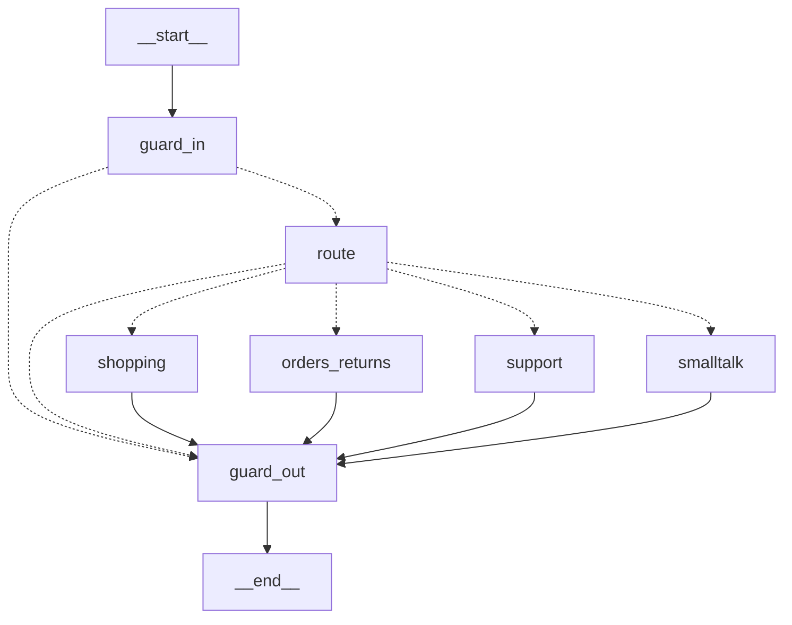

# 05. Python AI service and code map

Root: `ai-service/`. Entry point: `app.main:create_app` (`uvicorn app.main:create_app --factory --port 8090`, `e2e/ai/start-ai.sh:9`). Package layout (line counts at time of writing):

| Package | Responsibility | Key files |
|---|---|---|
| `app/main.py`, `services.py`, `errors.py`, `cache.py` | composition root, error contract, TTL cache | 81, 97, 51, 32 lines |
| `app/api/routes.py` | customer REST routes, health, metrics | 90 |
| `app/auth/jwt.py` | token verification, `Principal` | 78 |
| `app/config/settings.py` | all configuration (pydantic-settings) | 151 |
| `app/llm/` | provider abstraction, Vertex client, resilience | `base.py`, `vertex.py`, `resilient.py` |
| `app/agent/` | Customer Agent graph, runtime, shopping/orders/support nodes, prompts, templates, response schema | `graph.py` 263, `runtime.py` 98, `service.py` 205 |
| `app/router/` | Tier 0 rules, Tier 1 classifier, slot extraction | `tier0.py` 307, `tier1.py` 141 |
| `app/shop/` | live catalog access, hybrid product search, deterministic ranking | `catalog.py`, `search.py`, `ranking.py` |
| `app/tools/` | typed tool registry, tools, confirmation executor | `registry.py`, `shop_tools.py`, `account_tools.py`, `write_tools.py`, `support_tools.py`, `actions.py` |
| `app/mcp/server.py` | MCP facade over the registry | 101 |
| `app/rag/` | Tika client, chunking, embedding, ingest, retrieval, reindex | `ingest.py`, `chunking.py`, `tika.py`, `retrieval.py`, `embedder.py` |
| `app/guard/` | input guard, output grounding, untrusted-text handling, confirmation tokens | 4 files |
| `app/store/` | pool + schema, conversation/pending/audit store | `db.py`, `state.py`, SQL files |
| `app/inventory/` | Phase 2: forecasting, planning, scenarios, events, mart, copilot graph, REST | 13 files |
| `app/support/` | Phase 3: classification, investigation, decision, responses, flow | 7 files |
| `app/obs/` | logging, metrics, usage/cost, request context | 5 files |

## 1. Startup and dependency wiring

`create_app @ ai-service/app/main.py:26-91`:

1. Load `Settings` (`get_settings`), configure logging.
2. `lifespan` (lines 31-71) connects the store when `AI_DATABASE_URL` is set. **If the database is unavailable the service still starts** (lines 36-43: `store = None`, `store_error` recorded) so the AI never prevents commerce from working.
3. `check_embedding_config` records `model|dim` and reports `reindex_required` if they changed (lines 44-47).
4. `build_services` (the composition root, `ai-service/app/services.py:81-108`) builds, once: the `httpx` client, `DSportsClient`, `Catalog`, `UsageRecorder`, `VertexGemini` wrapped in `ResilientLLM`, `Embedder`, the state store, the tool registry, `ConfirmationService`, `ActionExecutor`, `Tier1`, and (when a store exists) `Retriever`, `ProductSearch`, `TikaClient`, `ProductIndexer`, `Ingestor`, `InventoryRepository`.
5. `ChatService(services)` and `InventoryCopilot(services)` are created; the MCP app is built and mounted lazily at `/mcp` (lines 58-62, 81-90).
6. Error handlers and the request-context middleware are installed (lines 76-77); routers included (78-79).

Tests can substitute collaborators through `create_app(**overrides)` (docstring at line 27); this is how the unit suite runs without Gemini or a database (`tests/unit/test_app.py`).

### Why a composition root
Everything is built in one place so tests and the CLI (`app/cli.py`, `app/support/cli.py`, `app/inventory/cli.py`) share it, and so every collaborator is constructor-injected (the Java project rule "constructor injection only" applies in spirit to the Python code).

## 2. HTTP API (customer assistant)

`ai-service/app/api/routes.py`:

| Route | Auth | Handler | Notes |
|---|---|---|---|
| `POST /v1/chat` | optional bearer (guests allowed) | `chat @ routes.py:19-23` | a present-but-invalid token is a 401, never a silent downgrade (`optional_principal @ app/auth/jwt.py:87-97`) |
| `POST /v1/confirm` | required | `confirm @ routes.py:26-29` | executes a previously proposed WRITE |
| `GET /v1/recommendations` | optional | `recommendations @ routes.py:32-39` | **no model call**; explainable rules (`app/agent/recommend.py`) |
| `GET /metrics` | open | `prometheus @ routes.py:42-44` | Prometheus text format |
| `GET /health`, `/health/dependencies`, `GET /v1/me` | none, none, required | `routes.py:49-82` | health never depends on the LLM; dependencies reports DB, DSports, Tika, breaker state |
| `/v1/inventory/*` | ADMIN | `app/inventory/api.py` (doc 10) | |
| `/mcp` | bearer per MCP call | `app/mcp/server.py` (doc 08) | |

The response model is `ChatResponse @ ai-service/app/agent/schemas.py:89-118`: a **structured** payload (products, comparison, orders, tracking, eligibility, `actions`, `sources`, `support`, `meta`) plus `message` and `messageSource` (`ai` or `deterministic`). The UI renders the structured parts as "verified from DSports" components and the text separately.

## 3. Configuration

All settings come from environment variables via `Settings @ ai-service/app/config/settings.py:12-141` (pydantic-settings, `.env` file, nothing secret has a default). Important ones:

| Variable | Default | Meaning |
|---|---|---|
| `JWT_SECRET`, `AI_CUSTOMER_HASH_KEY` | required | shared HS256 secret (>= 32 bytes), HMAC key for customer hashes (>= 16 bytes) |
| `DSPORTS_BASE_URL` | `http://localhost:8080` | Java backend |
| `AI_DATABASE_URL` | unset (store disabled) | `dsports_ai` database |
| `GOOGLE_APPLICATION_CREDENTIALS`, `GOOGLE_CLOUD_PROJECT`, `AI_VERTEX_LOCATION` | unset / `us-central1` | Vertex access; validator checks the credentials file exists (lines 136-141) |
| `AI_INTENT_MODEL` / `AI_REASONING_MODEL` | `gemini-2.5-flash-lite` / `gemini-2.5-flash` | Tier 1 / Tier 2 models |
| `AI_EMBEDDING_MODEL`, `AI_EMBEDDING_DIM` | `text-embedding-005`, 768 | embeddings |
| `AI_THINKING_BUDGET` | 0 | Gemini 2.5 thinking off (cost control, lines 44-46) |
| `AI_MAX_TOKENS`, `AI_TEMPERATURE`, `AI_TOP_K` | 1024, 0.2, 5 | generation and retrieval limits |
| `AI_MAX_TOOL_CALLS`, `AI_TIMEOUT_S`, `AI_REQUEST_TIMEOUT_S`, `AI_REQUEST_TOKEN_BUDGET`, `AI_MAX_ITERATIONS` | 8, 30, 90, 8000, 12 | loop and cost bounds |
| `AI_RATE_LIMIT_PER_MIN` | 30 | in-process per-customer limiter |
| `AI_CONFIRMATION_TTL_S` | 300 | confirmation token lifetime |
| `AI_BREAKER_FAILURES`, `AI_BREAKER_COOLDOWN_S` | 3, 30 | LLM circuit breaker |
| `AI_PRICE_TABLE_JSON` | `{}` | USD per 1M tokens per model; empty = cost not estimated |
| `AI_TIKA_URL`, `AI_OCR_MIN_CHARS_PER_PAGE`, `AI_CHUNK_TOKENS`, `AI_CHUNK_OVERLAP_TOKENS`, `AI_MIN_SIMILARITY`, `AI_RETRIEVAL_CANDIDATES` | see file | RAG parameters |
| `AI_SUPPORT_STALL_DAYS` | 3 | demo threshold for "shipment stalled" (`SYNTHETIC / POC` setting, not an SLA) |
| `AI_MCP_ENABLED`, `AI_MCP_ALLOWED_HOSTS` | true, localhost | MCP facade and DNS-rebinding protection |

`Settings.public_view` (lines 147-173) is the only form of configuration that is logged or returned: it contains no secret, credential path or connection string.

## 4. The Customer Agent (LangGraph)

Built by `build_customer_agent @ ai-service/app/agent/graph.py:319-335`. State is a `TypedDict` (`AgentState @ graph.py:40-45`: `message`, `route`, `slots`, `data`, `done`); the per-request runtime (tools, budgets, conversation) travels in `config["configurable"]["rt"]` (`_rt @ graph.py:48-49`, built in `ChatService._runtime @ ai-service/app/agent/service.py:90-93`).

### 4.1 Graph generated from the code (`get_graph().draw_mermaid()`)


(Dashed edges are conditional edges: `after_guard @ graph.py:97-98` and `dispatch @ graph.py:101-111`.)

| Question | Answer |
|---|---|
| Created where | `build_customer_agent`, graph.py:319 |
| State type | `AgentState` (graph.py:40) |
| Nodes | `guard_in`, `route`, `shopping` (subgraph), `orders_returns` (subgraph), `support` (subgraph), `smalltalk`, `guard_out` |
| Conditional routing | after `guard_in`: blocked -> `guard_out`, else `route`; after `route`: by intent set (`SHOPPING`, `ORDERS`/`CONFIRM`, `SUPPORT`, else smalltalk), or `guard_out` when a sign-in is needed |
| Nodes that call an LLM | **`route`** (only through `Tier1.classify`, when no rule matches); the shopping `explain`, `compare`, `knowledge` nodes (explanation text); `guard_out` calls none (it checks) |
| Deterministic nodes | `guard_in` (`check_input`), the order nodes, the support nodes, `smalltalk`, ranking and search inside `shopping` |
| Nodes that invoke tools | shopping, orders_returns, support subgraph nodes, through `rt.call` -> `ToolRegistry.call` |
| Termination | always `guard_out -> END`; limits: `recursion_limit = AI_MAX_ITERATIONS` and `asyncio.wait_for(..., AI_REQUEST_TIMEOUT_S)` (`service.py:154-158`); on timeout the turn becomes `status=error, TIMEOUT` (lines 162-164); any other exception becomes `AGENT_ERROR` (165-168) |
| Errors / missing info | tool failures set `status`/`error_code` and a deterministic text; missing details produce a question (e.g. `_ask_what`, `_ask_which_order`) |
| Proving tests | `tests/unit/test_agent.py` (63), `test_api_chat.py` (14), `test_router.py` (23), `test_guards.py` (29), `test_structured_responses.py` (22) |

### 4.2 The nodes in execution order (annotated)

**`guard_in`** (graph.py:54-62) runs the deterministic input guard before any model:

```python
verdict = check_input(state["message"])          # app/guard/input.py:78-99
if verdict.allowed:
    return {"done": False}
rt.turn.status = "refused" if verdict.category not in ("empty", "too_long") else "ok"
rt.turn.text = rt.turn.fallback_text = verdict.refusal or ""
rt.turn.error_code = f"GUARD_{verdict.category.upper()}" if verdict.category else None
return {"route": Route(Intent.BLOCKED, 0), "done": True}
```
`check_input` tests, in order: cross-customer data, internal info, staff-only actions, credentials, prompt extraction, privilege claims, injection patterns (`guard/input.py:85-98`). Each refusal is a fixed text (`REFUSALS`, lines 56-68), so a blocked turn costs zero tokens.

**`route_node`** (graph.py:65-94):

```python
route = rt.forced_route or tier0.classify(message, rt.conv, authenticated=..., known_products=...)
if route is None:
    try:
        route = await rt.services.tier1.classify(message, rt.conv, rt.customer_hash)   # cheap Gemini call
        ...
    except LLMError as exc:
        slots = extract_shopping_slots(message)
        if slots:  route = Route(Intent.PRODUCT_SEARCH, 0, slots, source="fallback")   # plain search
        else:      ... status "ai_unavailable" ...                                      # honest message
if route.intent not in GUEST_INTENTS and rt.principal is None:
    ... status "needs_login" ...
```
Three routers in order: (1) a tapped **offer** (`forced_route`, resolved by `offers.resolve`, so ids come from the service, never the client), (2) **Tier 0**: regex rules (`app/router/tier0.py:62-`), (3) **Tier 1**: Gemini Flash-Lite with JSON output (`app/router/tier1.py:140-161`). Tier 1 output is a *proposal* that `verify()` (tier1.py:108-132) cross-checks against the customer's own words (a number not in the message is dropped; sports/categories must be real catalogue values; the complaint type must be a member of the `Complaint` enum).

**`guard_out`** (graph.py:121-139) runs on every path. For AI-written text it extracts the facts from this turn's tool results (`collect_facts`, `guard/grounding.py:84-124`) and checks amounts, order/shipment/payment references, product names and status claims (`check_grounding`, 135-188). If anything is unsupported (or the system-prompt id `RULES_ID` leaked), the model text is replaced with the deterministic `fallback_text` and a disclaimer is added (lines 131-138). The Prometheus counter `ai_grounding_fallbacks_total` counts these replacements.

### 4.3 Shopping subgraph (`shopping_graph @ graph.py:203-218`)

Generated from code: `START` -(conditional `sh_dispatch`)-> one of `search | compare | knowledge | detail | reviews | recommend | kit`; `search -> explain`; every other node and `explain` go to `END`.

* `search` (`shopping.search @ ai-service/app/agent/shopping.py:61-84`) merges slots (`merge_search_slots`, 33-48), calls the `search_products` tool, remembers the shown products, and builds the **deterministic** text (`templates.products_text`).
* `explain` (`sh_explain @ graph.py:150-156`; `shopping.explain_search @ shopping.py:100-104`) is the **only** LLM node in a search: a plain keyword search (`slots.plain`) skips it and uses the deterministic text. Otherwise `_llm_text` asks Gemini (Tier 2) for a <=110-word explanation using `prompts.explain_search` (`app/agent/prompts.py:41-53`). Failures keep the deterministic text and add a disclaimer (shopping.py:107-123).
* `compare` (shopping.py:186-211): resolves product ids (ordinals, names, last shown), fetches each with `get_product`, builds a comparison table in code (`build_comparison`, 164-183), prepares a deterministic recommendation (`_deterministic_pick` uses `rank`), and only then asks the model to phrase advice (`prompts.advise`).
* `knowledge` (shopping.py:234-289): RAG answer; see doc 07.
* `recommend`/`kit` (`app/agent/recommend.py`): rule-based, explainable, no model.

### 4.4 Orders / returns subgraph (`orders_graph @ graph.py:252-270`)

One conditional edge from `START` to exactly one of 11 nodes (`orders_list, order_detail, track, payment, refund, cart, return_check, return_create, reorder, confirm_yes, confirm_no`), each ending at `END`. **No node in this subgraph calls an LLM directly** except `return_check`, which calls `shopping.knowledge` for a cited policy explanation after the eligibility verdict (orders.py:186-218). State-changing steps use `_propose` (orders.py:221-239), which prepares a proposal from live data and issues a confirmation token (doc 08).

### 4.5 Support subgraph (`support_graph @ graph.py:299-314`)

Generated from code: `START` -> one of `policy | refund_why | case | complaint | case_create | case_status | case_message | case_escalate | case_reopen` -> `END`. **Important accuracy note:** the steps *classify -> identify order/product -> investigate -> decide -> respond -> propose case* are **not** separate LangGraph nodes. They run inside one node, `complaint`, which calls ordinary async functions in `app/support/flow.py` (`complaint @ flow.py:76-97`, `respond_to @ flow.py:100-140`). LangGraph provides routing and a uniform runtime; the workflow itself is Python code. Details in doc 11.

LLM use inside this subgraph: the `policy` and `refund_why` nodes (`app/agent/support.py:21-38`) call `shopping.knowledge`, which asks Gemini Tier 2 to answer from cited passages (with a deterministic fallback). The Phase 3 case nodes (`complaint`, `case_*`) call **no** generation model: their customer text is composed by code (`app/support/respond.py`); the only model involvement is the Tier 1 router that may have classified the message, and the embedding call for policy retrieval.

Stale code found while inspecting: `support_case @ ai-service/app/agent/support.py:41-46` (and the module docstring, lines 1-2) still describe the Phase 1 "no ticketing" behaviour. It is **unreferenced** (the `case` node now calls `support_flow.complaint`, `graph.py:280-284`), so it is dead code with an outdated message (recorded in the coverage report; not changed because this task is documentation-only).

## 5. Runtime and the LLM gateway

`Runtime @ ai-service/app/agent/runtime.py:55-114` holds the services, tool context, conversation, principal, the accumulating `Turn` (everything the response will contain, lines 23-52), counters (`llm_calls`, `tokens_in/out`, `models`, `cost`). `Runtime.ask` (93-107) is the **only** way nodes reach the model and enforces the per-request token budget (`BudgetExceeded`, lines 96-97). `Runtime.call` (109-110) is the only way to reach a tool.

## 6. Service layer for one turn

`ChatService.chat @ ai-service/app/agent/service.py:143-178`:

1. rate limit (`RateLimiter.allow`, 32-44: sliding window per customer hash; guests per conversation id),
2. load or create the conversation owned by the caller (`_conversation`, 81-88; someone else's id silently starts a fresh conversation),
3. apply product context and tapped choice (97-126),
4. invoke the graph with timeout and recursion limit (154-158),
5. `_finish` (208-226) builds suggestions, stores the rolling summary and the conversation, and assembles `ChatResponse` with `Meta` (tools used, tokens, cost estimate, models, latency, grounding report),
6. increments `ai_requests_total{intent,tier,outcome}` and logs one structured line per turn (172-177).

`ChatService.confirm` (181-196) redeems a confirmation token and applies the outcome (doc 08).

## 7. Conversation state and persistence

`ConversationState @ ai-service/app/store/state.py:25-50` is deliberately small: intent, slots, last products, last order, selected product, comparison ids, pending nonce/token, rolling summary (<=600 chars built by rules, no model, `make_summary @ service.py:47-67`), turns. Stored per owner (`customer_hash` or `GUEST`) with a 24 h TTL. `PgStateStore` / `MemoryStateStore` implement one `StateStore` protocol; `ResilientStateStore` (193-220) serves conversation reads/writes from memory if the database fails but **refuses** durable writes (pending actions, audit): a state-changing action is never executed without an audit record.

## 8. Guardrails and authorization boundaries (code locations)

* Input guard: `app/guard/input.py` (pattern based, deterministic).
* Output grounding: `app/guard/grounding.py`; inventory numeric grounding: `app/inventory/grounding.py`.
* Untrusted text: `app/guard/untrusted.py` (`find_injection`, `sanitize_untrusted`, `fence`).
* Tool boundary: `ToolRegistry._gate` (`registry.py:110-120`), strict arguments (`StrictArgs`, `extra=forbid`).
* Identity: `Principal` from the verified JWT only (`app/auth/jwt.py:28-37`).
* Authorization of business data: Java.

## 9. Retries, timeouts, fallbacks

| Layer | Behaviour | Code |
|---|---|---|
| HTTP to Java | per-call timeout (`AI_TIMEOUT_S`), connect timeout 5 s, connection pool 50 | `build_client @ app/tools/dsports_http.py:13-18`; errors mapped to `ToolError` codes (`dsports_client.py:41-47, 67-83`) |
| Tool execution | `asyncio.wait_for(timeout = 2 x AI_TIMEOUT_S)`, per-request call budget (8) | `registry.py:122-149` |
| LLM generate/embed | one retry on `LLM_TIMEOUT`/`LLM_ERROR` (never on quota), breaker opens after 3 consecutive failures for 30 s, half-open probe | `ResilientLLM`, `CircuitBreaker @ app/llm/resilient.py:24-95` |
| Whole request | `AI_REQUEST_TIMEOUT_S` (90 s) | service.py:154-164 |
| Embeddings | if embedding fails, retrieval **degrades to keyword-only** | `Retriever._query_vector @ app/rag/retrieval.py:69-76` |
| Database | service starts without it; conversation falls back to memory | `main.py:36-43`, `state.py:193-220` |

## 10. Observability, evaluation and tests (pointers)

Observability: doc 15. Tests and evaluation: doc 14. The Python test inventory (test counts by file, from `def test_` counts) is in doc 14 and doc 17.

## 11. Where each phase lives in this service

* Phase 1: `app/agent`, `app/router`, `app/shop`, `app/rag`, `app/tools` (account/shop/write), `app/guard`.
* Phase 2: `app/inventory` (graph in `copilot.py`, REST in `api.py`).
* Phase 3: `app/support` plus `app/tools/support_tools.py`, router and guard extensions, and the `support` subgraph above.
