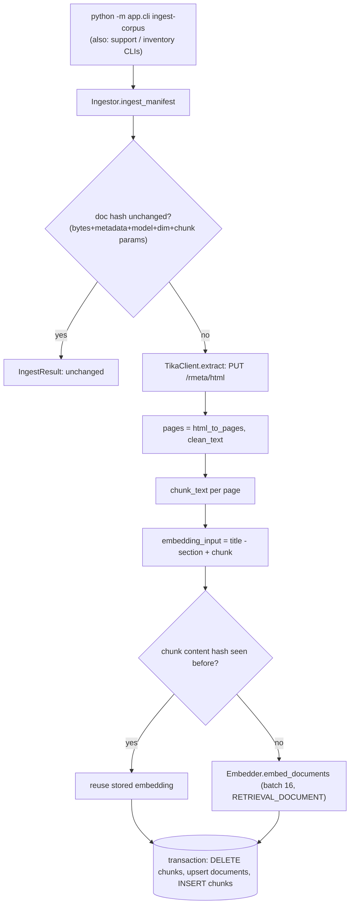
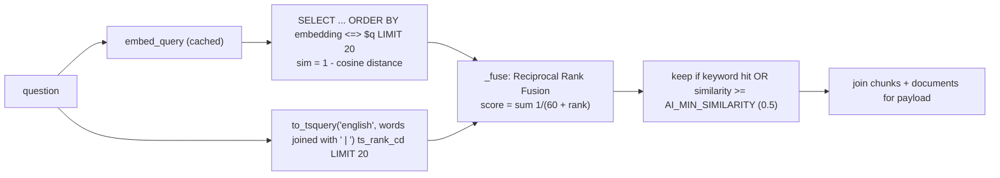

# 07. RAG, Tika, OCR, embeddings and pgvector

Code: `ai-service/app/rag/` (ingest, chunking, tika, embedder, retrieval, products, reindex), `ai-service/app/store/schema_rag.sql`, `ai-service/app/tools/shop_tools.py` (`get_product_knowledge`), `ai-service/app/agent/shopping.py` (`knowledge`), `ai-service/app/agent/prompts.py` (`answer_from_sources`).

## 1. What problem RAG solves here, and what it must not be used for

Solves: answering *document* questions ("how do I knock in a bat?", "what is the return policy?", "what does a pending payment mean?") with cited passages from a knowledge base, and doing semantic product search over descriptions/attributes.

**Not** the source of truth for current facts. The product index stores no price or stock (`schema_rag.sql:1-2`), and `get_product_knowledge` results are excluded from the "live facts" sets used by the grounding check (`DOCUMENT_TOOLS` in `ai-service/app/guard/grounding.py:72`, `Facts` docstring lines 44-48): a policy that merely contains the word "COMPLETED" must not make "your refund was completed" pass. Order status, refund state, inventory and eligibility always come from Java.

## 2. Supported document types and the corpora

`_CONTENT_TYPES @ ingest.py:28-30`: `.md`, `.txt`, `.pdf`, `.html`, `.docx`, `.png`, `.jpg/.jpeg`. Manifests list documents with `documentType` (`guide|care|warranty|policy|faq|spec|procedure`, `DocType @ shop_tools.py:19`; internal families `inv_*`, `sup_*`).

| Corpus | Directory | Audience | Content |
|---|---|---|---|
| Customer | `ai-service/corpus/` | customers and guests | cricket bat guide/care, running shoe guide, FAQ, shipping/return/refund policies, warranty (a scanned PDF to exercise OCR), a product care sheet, and Phase 3 procedures (missing delivery, damaged/wrong product, payment problems, exchange policy, support cases guide) |
| Inventory | `ai-service/corpus_inventory/` | ADMIN only (`inv_*`) | replenishment, clearance/promotion, event, transfer, supplier/MOQ, category strategy |
| Support | `ai-service/corpus_support/` | staff only (`sup_procedure`) | triage SOP, escalation matrix |

`SYNTHETIC / POC DATA`: every document is a **labelled sample** written for the POC; none is an official DSports policy, SLA or manufacturer document.

## 3. Ingestion flow

Code, in order (`Ingestor.ingest @ ai-service/app/rag/ingest.py:87-143`):

1. `doc_hash = content_hash(bytes, metadata json, embedding model, dim, chunk size, overlap)` and compare with `documents.content_hash`: unchanged -> skipped entirely (lines 90-95). This is why re-ingestion is cheap and idempotent.
2. `tika.extract(data, content_type)` (line 97), then `clean_text` per page: NFKC normalisation, control characters removed, hyphenated line breaks joined, blank-line collapse (`clean_text @ ingest.py:68-74`).
3. `chunk_text(page, 450, 60)` per page (lines 99-102).
4. What is embedded is `title - section` + chunk (`embedding_input`, 77-80) so a chunk titled "Step 2" still carries its topic.
5. Per-chunk hash `content_hash(input, model)`; chunks whose hash already exists for that document **keep their stored embedding**, only new text is embedded (lines 107-115).
6. One transaction: delete old chunks, upsert the document row (`ON CONFLICT (source) DO UPDATE`), insert chunks with deterministic ids `uuid5(source:index:hash)` (117-136).

### Tika and OCR (`ai-service/app/rag/tika.py`)
* `TikaClient.extract @ tika.py:90-123` PUTs to `/rmeta/html`, converts the paged HTML to light Markdown that keeps `#` headings (`markup_to_text`, 60-66) so the chunker can split on them.
* **OCR strategy (measured, not assumed; docstring lines 1-14):** Tika 4 disables per-request parser configuration, so a literal "extract without OCR, retry with OCR" is not possible. Tika's default already runs Tesseract only on pages without a text layer and reports `pdf:chars-per-page` and `pdf:ocr-page-count`. The code uses these: a PDF whose digital text averages fewer than `AI_OCR_MIN_CHARS_PER_PAGE` (50) characters per page is a **scan**; `ocr_used` is recorded from the real OCR page count; a scan that yields no text raises `NO_TEXT` (lines 115-120). Images are OCR'd by Tika (lines 112-114).
* Limits: OCR quality depends on Tesseract; there is a single scanned sample (`warranty-card-scanned.pdf`); no evaluation of OCR accuracy on real manufacturer scans exists (`UNKNOWN`). Tests: `tests/unit/test_tika.py` (8), `tests/integration/test_rag_db.py` (16), `tests/live/test_stack_rag.py` (5).

## 4. Chunking strategy

`chunk_text @ ai-service/app/rag/chunking.py:113-149` (docstring 1-14): split at Markdown headings and blank lines into units that remember their heading path (`Care > Cleaning`); split oversized units by sentence, then by word; pack units greedily up to ~450 tokens; repeat the last ~60 tokens at the start of the next chunk (overlap); drop a trailing chunk that is only the overlap. Tokens are *estimated* as `ceil(chars/4)` (`count_tokens`, line 25), not the model tokenizer. Each chunk has `index`, `text`, `section`, `tokens`. Tests: `tests/unit/test_chunking.py` (18).

## 5. Embeddings and the vector schema

`Embedder @ ai-service/app/rag/embedder.py:25-57`: batches of 16 documents, validates the returned dimension (`EMBEDDING_DIMENSION_MISMATCH` if it differs from `AI_EMBEDDING_DIM`, lines 33-36), caches **query** embeddings by normalised text for `AI_CACHE_TTL_S` (queries are not customer-specific vectors, so sharing is safe). `Store.check_embedding_config` stores `model|dim` and reports `reindex_required` if either changed (`store/db.py:49-62`); `app/rag/reindex.py` rebuilds vectors.

Schema (`ai-service/app/store/schema_rag.sql`, `{{DIM}}` = 768):

| Table | Important columns |
|---|---|
| `product_index` | `product_id` (UUID PK), `sku`, `name`, `brand`, `category`, `sport`, `attributes` JSONB, `weight_g`, `search_text`, `content_hash`, `embedding vector(768)`, `embedding_model`, generated `tsv tsvector`; indexes: GIN on `tsv`, **HNSW** `vector_cosine_ops` on `embedding`, btree `(sport, category)` |
| `documents` | `id` UUID PK, `source` UNIQUE, `document_type`, `title`, `version`, `language`, `pages`, `ocr_used`, `content_hash`, `embedding_model`, `ingested_at` |
| `chunks` | `id`, `document_id` FK (cascade), `product_id`, `category`, `sport`, `brand`, `document_type`, `source`, `version`, `language`, `page`, `chunk_index`, `section`, `content`, `content_hash`, `embedding vector(768)`, generated `tsv`; GIN on `tsv`, **HNSW** on `embedding`, btree `(document_id, chunk_index)` and `(document_type, sport, category)` |

## 6. Retrieval: hybrid search

`Retriever.search_chunks @ ai-service/app/rag/retrieval.py:113-161`:

* Metadata filters are applied **inside both SQL queries** (`document_types`, `sport`, `category`, `product_id`; general documents with NULL sport/category always qualify, lines 122-132).
* **Internal-document isolation is in SQL, not in a prompt:** for customers the clause is `c.document_type NOT LIKE 'inv\_%' AND NOT LIKE 'sup\_%'`; `internal=True` allows only `inv_`; `internal="sup_"` only `sup_`; the prefix is chosen from the fixed map `INTERNAL_PREFIXES` (lines 26-27, 120-121) and nothing a caller supplies is interpolated. Tests: `tests/integration/test_rag_db.py`, `tests/integration/test_inventory_safety_db.py` (4), `tests/integration/test_support_documents_db.py` (5, real PostgreSQL).
* RRF avoids calibrating two incomparable score scales (`rrf_fuse`, lines 31-36; `RRF_K = 60`).
* If embedding fails, retrieval **degrades to keyword-only** (lines 69-76).
* No reranker (off by default; lines 7-9).
* Product search (`search_products`, lines 79-110) uses the same pattern over `product_index`.

## 7. Context assembly, grounding and citations

`get_product_knowledge @ ai-service/app/tools/shop_tools.py:92-116` turns hits into dictionaries `{chunk_id, source, title, page, document_type, section, text, similarity, keyword_rank, vector_rank, flagged_injection}` after `sanitize_untrusted` (injection-like sentences replaced by `[instruction-like text removed]`, counted in `ai_guard_blocks_total{stage="retrieval"}`).

`shopping.knowledge @ shopping.py:234-289` then:
1. calls the tool (with product/sport/category context from the conversation),
2. no chunks -> fixed "couldn't find enough information" (`NOT_ENOUGH`),
3. builds a deterministic `fallback_text` from the top passage,
4. asks Gemini with numbered, fenced sources (`answer_from_sources`),
5. `INSUFFICIENT_INFORMATION` -> `NOT_ENOUGH`; no `[n]` citation -> show the passage instead; else keep the AI answer and attach `sources` for exactly the cited numbers (each `{source, title, page, document_type, chunk_id, snippet}`).

The UI shows them with `SourcesList` (`frontend/src/features/ai/SourcesList.tsx`).

## 8. One end-to-end example (Journey D)

Question (real corpus): "What should I do if my order is marked delivered but I did not receive it?"

1. `POST /v1/chat` -> `guard_in` allows -> Tier 0 support rules route to a complaint, or `search_support_policy` is called by the investigation (`POLICY_QUESTION[MISSING_DELIVERY]`, `ai-service/app/support/investigate.py:26-46`).
2. `search_support_policy` (`support_tools.py:184-185`) -> `get_product_knowledge` with `document_types=["policy","faq","warranty","procedure"]`.
3. `search_chunks`: query embedded (`RETRIEVAL_QUERY`), vector + keyword lists, RRF, similarity floor; `sup_*` and `inv_*` excluded.
4. The top hit is a chunk of `missing-delivery-procedure.md` (`document_type: procedure`), section "If it is marked delivered but you did not receive it".
5. `best_passage` (`investigate.py:162-175`) picks the most relevant paragraph (section heading counts toward its paragraphs); the investigation adds `Fact("POLICY", "Applicable guidance: Missing or Late Delivery Procedure (sample).")` and a `policy` entry with `source`, `title`, `chunk_id`, `snippet`.
6. The customer sees the passage as a labelled quote next to the verified order/shipment facts; the policy never overrides the facts. In the Phase 3 flow no generation model is involved in this answer.

## 9. Retrieval failure, empty results, document updates
* Empty results: policy missing -> `Missing("An applicable support policy", ...)` in the investigation (`_policy @ investigate.py:178-188`): the assistant says it cannot cite a procedure instead of inventing one.
* Document update: change the file or manifest -> new `doc_hash` -> re-ingested; unchanged chunks reuse embeddings. `ingest.remove(source)` deletes a document (cascade removes chunks, lines 156-158).
* Model/dimension change: `reindex_required`, then `app/rag/reindex.py`.

## 10. Evaluation of retrieval quality
Phase 1 main evaluation (83 cases): retrieval hit@5 = 1.00 on 19 checks, MRR reported as 1.00 in `docs/ai/09-evaluation.md` and 0.94 in the Phase 2 stabilisation report (`docs/ai/phase2/14-final-stabilization-report.md` section 7): **a documented inconsistency**; the latter is the later measurement (see coverage report). Small corpora (a few dozen chunks) and sample documents mean these numbers do not predict performance on a large real corpus (`UNKNOWN`).

## 11. Customer vs internal boundary: summary
Customer retrieval can never return `inv_` or `sup_` documents (SQL filter). Staff support documents exist (`corpus_support/`) and are ingested, but **no staff-facing retrieval path to them was found in the code**: `search_support_policy` is a customer tool restricted to customer document types, and `retrieval.py` supports `internal="sup_"` but no caller was found passing it. Treat staff-document retrieval as `PARTIALLY IMPLEMENTED` (isolation is implemented and tested; a consumer is not).
