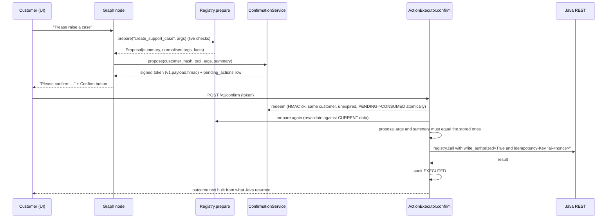

# 08. Typed tools, MCP and business actions

Code: `ai-service/app/tools/` (`registry.py`, `shop_tools.py`, `account_tools.py`, `write_tools.py`, `support_tools.py`, `actions.py`, `dsports_client.py`, `build.py`), `ai-service/app/inventory/tools.py`, `ai-service/app/mcp/server.py`, `ai-service/app/guard/confirmation.py`.

## 1. Vocabulary (interview-ready)

| Term | In this project |
|---|---|
| **Tool** | a typed Python function plus metadata registered in the single `ToolRegistry`: `Tool(name, description, kind READ/WRITE, args_model, handler, requires_auth, prepare?, required_role?)` (`ai-service/app/tools/registry.py:78-87`) |
| **Tool registry** | the one place that decides what the assistant can do. `build_registry @ tools/build.py:9-13` registers all 39 tools (verified by running it) |
| **MCP server** | a network facade (Model Context Protocol, official SDK, streamable HTTP at `/mcp`) that exposes the same registry to external MCP clients (`build_mcp_server @ mcp/server.py:82-122`) |
| **MCP client** | not part of the product code. The agent calls the registry **in-process**. MCP clients are external programs; tests act as the client (`tests/unit/test_mcp.py` 6, `tests/live/test_stack_mcp.py` 5, `test_stack_mcp_inventory.py` 6) |
| **LangGraph node** | a function in the agent graph that does one step (e.g. `track`); it may call tools |
| **LLM** | a text generator; here it never selects or runs tools |

## 2. The tool inventory (generated by running `build_registry()`)

READ tools (33) unless marked WRITE. "Auth" = requires a verified bearer token; "Role" = enforced by the registry for every caller (REST agent and MCP).

| Tool | Kind | Auth | Role | Purpose / downstream call | Source |
|---|---|---|---|---|---|
| `search_products` | READ | no | none | hybrid search + live price/stock + deterministic ranking (`GET /api/catalog/...`, `/api/prices`, `/api/inventory`) | `shop_tools.py:58-64` |
| `get_product` | READ | no | none | one product with live price, stock, rating | `shop_tools.py:67-72` |
| `get_product_reviews` | READ | no | none | approved reviews; reviewer identity never copied | `shop_tools.py:75-89` |
| `get_product_knowledge` | READ | no | none | cited knowledge passages (RAG) | `shop_tools.py:92-116` |
| `get_customer_profile` | READ | yes | none | first name only | `account_tools.py:120-122` |
| `get_cart` | READ | yes | none | `GET /api/v1/cart` | `account_tools.py:125-131` |
| `get_orders`, `get_order` | READ | yes | none | `GET /api/v1/orders[/{id}]` | `account_tools.py:134-160` |
| `track_order` | READ | yes | none | `GET /api/v1/shipments/by-order/{id}` | `account_tools.py:163-175` |
| `get_payment_status`, `get_refund_status` | READ | yes | none | `/api/v1/payments/history`, `/{id}/refunds` | `account_tools.py:185-206` |
| `check_return_eligibility` | READ | yes | none | `GET /api/v1/orders/{id}/returns/eligibility` (Java decides) | `account_tools.py:209-215` |
| `create_return` | **WRITE** | yes | none | `POST /api/v1/returns` (Idempotency-Key) | `write_tools.py:55-60` |
| `reorder_product` | **WRITE** | yes | none | `POST /api/v1/cart/items` (adds to cart; never orders or pays) | `write_tools.py:104-112` |
| `get_return_status` | READ | yes | none | `GET /api/v1/returns` | `support_tools.py:153-160` |
| `get_customer_support_cases`, `get_support_case` | READ | yes | none | `GET /api/v1/support/cases[/{ref}]` (customer view only) | `support_tools.py:163-181` |
| `search_support_policy` | READ | no | none | support procedures from the knowledge base | `support_tools.py:184-185` |
| `create_support_case` | **WRITE** | yes | none | `POST /api/v1/support/cases` | `support_tools.py:218-227` |
| `add_case_message` | **WRITE** | yes | none | `POST /api/v1/support/cases/{ref}/messages` | `support_tools.py:251-253` |
| `request_case_escalation` | **WRITE** | yes | none | `POST /api/v1/support/cases/{ref}/escalate` | `support_tools.py:268-270` |
| `reopen_support_case` | **WRITE** | yes | none | `POST /api/v1/support/cases/{ref}/reopen` | `support_tools.py:283-285` |
| 17 inventory tools (`get_inventory_overview` ... `get_inventory_policy`, `run_promotion_scenario`, ...) | READ | yes | **ADMIN** | persisted forecasts, deterministic plans, what-if scenarios; reads `dsports_ai` (`inv_*`), not Java | `ai-service/app/inventory/tools.py:116-261` |

Notes:
* `run_promotion_scenario` is registered as READ (it changes nothing in DSports) but it records the calculation in `inv_scenario_run` and `inv_audit` (`app/inventory/api.py:162-167` docstring: "Logged, not executed"). No inventory tool changes a price, purchase order, stock level or promotion: there is **no inventory WRITE tool** (`tools.py:1-5`; test `test_every_inventory_tool_is_read_only_and_admin_only`).
* No staff support operation (assign, notes, resolve, status, analytics) is a tool (`support_tools.py:1-8`). The staff console calls Java directly with the staff member's token.

## 3. Argument validation and identity

* `StrictArgs` sets `extra="forbid"` (`registry.py:33-35`): any unknown field (`customerId`, `userId`, `price`) is an `INVALID_ARGUMENTS` error. **No tool takes a customer id**; identity is the verified token in `ToolContext.principal` (`registry.py:46-61`).
* Examples of strict typing: `OrderRefArgs` requires exactly one of id/number/latest and validates the number format (`account_tools.py:34-46`); `CaseRefArgs` validates `CASE-\d{8}-\d{6}` or a UUID, which also keeps path traversal characters out of the URL (`support_tools.py:23, 61-69`); inventory arguments bound `limit`, `days`, discount percent 0-70 (`inventory/tools.py:22-90`).
* Results are **whitelists built field by field** (docstring `account_tools.py:1-5`): addresses, phones, emails, user ids and payment-instrument details are never copied.

## 4. Invocation lifecycle (`ToolRegistry.call`, `registry.py:122-149`)

1. `_gate` (110-120): unknown tool -> `UNKNOWN_TOOL`; needs auth and no principal -> `AUTH_REQUIRED`; `required_role` missing -> `FORBIDDEN`; `ctx.calls >= max_calls` -> `TOOL_BUDGET_EXCEEDED` (loop stopper, default 8).
2. Validate arguments with the Pydantic model -> `INVALID_ARGUMENTS` (names of bad fields only).
3. A WRITE tool without `ctx.write_authorized` -> `CONFIRMATION_REQUIRED`.
4. `asyncio.wait_for(handler, timeout = 2 x AI_TIMEOUT_S)`; `ToolError` -> its code; timeout -> `TOOL_TIMEOUT`; any other exception -> `TOOL_ERROR` (logged with stack, customer sees a generic message).
5. `_finish` records latency in `ai_tool_latency_seconds{tool,status}`, appends to `ctx.trace` (returned to the client in `meta.tools`) and `ctx.results` (the grounding check's evidence), and logs one line.

Tool errors never raise into the graph; they return `ToolResult(ok=False, error_code, error_message)`, and nodes turn them into customer-safe text (e.g. `_fail @ app/agent/orders.py:37-44`, `Gatherer.call @ app/support/investigate.py:68-74`).

## 5. How "the model chooses a tool" actually works (it doesn't)

Routing is Tier 0 rules or a Tier 1 **intent** classification; the `Intent` selects a graph node; the node (ordinary Python) decides which tools to call and with what arguments, for example `track` -> `rt.call("track_order", ...)`. The model has no tool schemas, no function-calling configuration and no ability to emit a tool call. This removes an entire class of tool-misuse and prompt-injection risk, at the cost of flexibility: new capabilities need a new rule/intent and node (an honest trade-off, doc 16).

## 6. READ example (traced)

`track_order` (`account_tools.py:163-175`): `resolve_order` lists the customer's own orders (`GET /api/v1/orders`) and picks the match, so another customer's order is simply not in the list; a directly supplied id that is not in the list is re-checked by Java (403/404) and never returned (lines 77-97). Then `GET /api/v1/shipments/by-order/{id}` (`allow_404=True`), and a whitelist dict with shipment number, tracking number, courier, status, ETA, timestamps and the last five events.

## 7. WRITE workflow (real, implemented)

Key code:

* `orders._propose @ app/agent/orders.py:221-239`: prepare from live data; if impossible, say why; otherwise issue a token, store pending nonce/token in the conversation, add a `confirm` action with the exact summary, set `requiresConfirmation`.
* `ConfirmationService.propose / redeem @ app/guard/confirmation.py:69-108`. Token format `v1.<base64url(payload)>.<base64url(HMAC-SHA256)>`; payload `{n nonce, c customer hash, t tool, a sha256(canonical args), e expiry}`. The arguments are **stored server-side**; the client never resends them, so there is nothing to tamper with. A dedicated sub-key is derived for signing (line 61). All failures collapse into a few generic codes (`CONFIRMATION_INVALID/EXPIRED/ALREADY_USED`).
* Atomic single use: `PgStateStore.consume_pending` runs `UPDATE ... SET status='CONSUMED' WHERE nonce=$1 AND customer_hash=$2 AND status='PENDING' AND expires_at > now() RETURNING *` (`store/state.py:164-170`).
* `ActionExecutor.confirm @ app/tools/actions.py:32-66`: redeem -> audit `CONFIRMED` -> **revalidate** (`registry.prepare` again; if `proposal.args` or the summary differ -> `STATE_CHANGED`) -> `ctx.write_authorized = True` (the only place a WRITE is ever authorised, line 54) with `idempotency_key = f"ai-{nonce}"` -> execute -> audit `EXECUTED` / `EXECUTION_FAILED`.
* If the audit table cannot be written, `ResilientStateStore` raises: the action is **refused** rather than executed without a trail (`store/state.py:196-198`).
* Java then validates again independently: ownership, eligibility (`ReturnPolicy`), idempotency (`CreateReturnUseCase`, `CreateSupportCaseUseCase`).
* Chat confirmation: "yes" while a proposal is pending routes to `confirm_yes` (`orders.confirm_yes @ orders.py:276-285`; Tier 0 `_YES` regex, `tier0.py:16-17, 72-79`); a bare "yes" with nothing pending is answered without any action.

What a duplicate WRITE does: a second redeem finds the row `CONSUMED` -> `CONFIRMATION_ALREADY_USED`, no call to Java. If the same case creation is retried at the REST level with the same `Idempotency-Key` the Java use case returns `REPLAYED` (doc 11, 12).

## 8. MCP facade

`build_mcp_server @ ai-service/app/mcp/server.py:82-122`:
* every **READ** tool is exposed with its real argument schema generated from the Pydantic model (`_typed_function`, 52-75), so MCP publishes the same schema;
* **WRITE tools are not directly callable**: clients call `propose_action(tool, arguments)` (returns a summary and a single-use token) then `confirm_action(confirmation_token)` (lines 93-118): same confirmation service, revalidation and audit;
* authentication is the bearer token on each HTTP request, verified with `verify_token`; without a token only tools with `requires_auth=False` work (`_principal`, 31-44);
* host allow-list for DNS-rebinding protection: `TransportSecuritySettings(allowed_hosts=...)` (`main.py:58-62`);
* a stale docstring: `propose_action`'s description names `create_return, reorder_product` (line 94) although `write_tools` contains all six WRITE tools; behaviour is correct, the text is outdated (coverage report).

Evidence: `tests/unit/test_mcp.py`, `tests/live/test_stack_mcp.py` (real stack, tools discovered, forged `customer_id`, anonymous and cross-customer denial; unknown arguments are dropped by the typed signature), `test_stack_mcp_inventory.py` (17 tools x customer/anonymous/tampered tokens: refused for non-ADMIN).

## 9. Audit
`audit` table rows: `PROPOSED`, `CONFIRMED`, `CONFIRM_REJECTED` (expired, replay/unknown, mismatch), `REVALIDATION_FAILED`, `EXECUTED`, `EXECUTION_FAILED`, each with customer hash, tool, args hash, conversation id, correlation id (`store/schema.sql:23-36`, `ConfirmationService`, `ActionExecutor`). Inventory has its own `inv_audit` (denials, queries, trainings, scenarios). Java has `support_case_events` (doc 11/12).

## 10. Preventing arbitrary HTTP/SQL/unauthorized execution
* The model cannot name a URL, SQL or a tool; handlers contain fixed paths with validated parameters.
* The DSports client takes only a path and parameters from handlers, forwards the caller's token, and maps upstream errors to a small set of codes without echoing bodies (`dsports_client.py:55-83`).
* Inventory SQL is parameterised in the repository; the retrieval prefix is chosen from a fixed map.
* `sanitize_untrusted` guards text that flows back into prompts.

## 11. Which tools exist for which phase
* Customer AI (Phase 1): shop (4) + account (8) + `create_return`, `reorder_product`.
* Inventory Intelligence (Phase 2): 17 ADMIN READ tools, no WRITE.
* Support (Phase 3): 4 READ + 4 WRITE.
