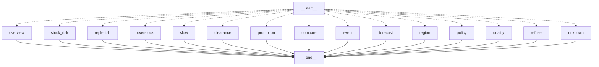

# 10. Phase 2: Inventory Intelligence

> **Boundary, stated once and meant everywhere.** All demand history, stock positions, purchase orders, suppliers, lead times, costs, regions and events in this phase are the labelled **`SYNTHETIC / POC DATA`** (`POC_SYNTHETIC` / `POC_REFERENCE`) generated by `ai-service/app/inventory/generator.py`. Accuracy figures below measure the *pipeline on that data*, **not** the accuracy of any forecast of real DSports demand. Catalogue, selling price and current sellable stock are real DSports data (`DSPORTS_LIVE`).

Code: `ai-service/app/inventory/` (`generator.py`, `quality.py`, `forecasting.py`, `events.py`, `scenarios.py`, `planning.py`, `pipeline.py`, `repository.py`, `tools.py`, `understand.py`, `copilot.py`, `grounding.py`, `api.py`, `cli.py`, `schema_inventory.sql`), UI `frontend/src/features/inventory/`, docs `docs/ai/phase2/`, ADR `docs/adr/ADR-010-inventory-intelligence.md`.

## 1. Data sources and ownership

| Data | Source | Label | Table |
|---|---|---|---|
| catalogue, live selling price, current sellable stock | Java REST (`Catalog.taxonomy/list_products/prices/stock`) | `DSPORTS_LIVE` | `inv_sku` (price, `dsports_available`) |
| cost, supplier, lead time, MOQ, case pack, regions, events | assumed by the generator | `POC_REFERENCE` | `inv_sku`, `inv_region`, `inv_event` |
| two years of daily demand per SKU and region, stock snapshots, stock positions (with FIFO age), open purchase orders | generated | `POC_SYNTHETIC` | `inv_demand_daily`, `inv_stock_snapshot`, `inv_position`, `inv_purchase_order` |

Why synthetic: the audit in the repository found the real database has about five weeks of mostly test orders, one warehouse, only a current stock snapshot, no purchase cost, supplier or lead time, and no regional dimension (`generator.py:1-17`, `docs/ai/phase2/02-data-model.md`, `e2e/ai/inventory_real_data_audit.py`). A forecasting model needs at least a year of daily history.

The generator is deterministic (`SEED = 20_261_008`, `HISTORY_DAYS = 730`, per-SKU seeding, lines 28-31). It builds trend, weekly and annual seasonality, sport seasons, tournament/marathon/Olympics uplift with a run-up, regional variation, fast/slow/declining movers, promotions with a real elasticity and a post-promotion dip, stock-outs that **censor** demand, stock corrections, FIFO age, open POs, and a few injected defects (missing days). A few **scripted situations** (at risk, overstock, slow) are pinned to named categories (`_PINNED`, lines 55-62) so the demo has something to find; they are inputs, not discoveries (docstring lines 14-15). The forecasting code never reads the generator's parameters.

`seed(...)` (`pipeline.py:37-99`) truncates and reloads every `inv_*` data table in one transaction (idempotent, reproducible); every row carries `data_source`.

## 2. Data preparation (`forecasting.clean_series`, `forecasting.py:56-87`)

Plain English: the model should learn *baseline* demand, so days that do not represent it are masked and replaced:
* negative units (returns/corrections) are treated as missing;
* a day where at least 20 % of regional demand was stock-censored is "unusable" (sales understate demand);
* promotion days **plus the following 7 days** (post-promotion dip), event days, and missing days are masked;
* masked days are imputed with the median of the same weekday over the previous 8 clean weeks (fallback: clean mean) (`_impute`, 77-87).
Missing region-days are rebuilt from observed regions scaled by regional share (`total = nansum / covered`, lines 61-62). `quality.report` (`quality.py:17-62`) reports (does not hide) missing dates, duplicates, negatives, zero-sales days, stock-out days, outliers (> 6 robust SD), insufficient history (< 56 clean days -> **no forecast**: "Insufficient data to produce a reliable forecast"), and missing reference data.

## 3. Forecasting algorithms (all deterministic, numpy only; no LLM)

| Model | Idea (plain English) | Code |
|---|---|---|
| `moving_average_28` (the naive **baseline**) | tomorrow looks like the average of the last 28 days | `forecasting.py:92-93` |
| `seasonal_naive_7` | each weekday looks like the same weekday averaged over the last 4 weeks | 96-101 |
| `holt_winters` | smooth level, a damped trend (`phi = 0.97`) and an additive weekly pattern; parameters chosen from a small grid by one-step squared error | 104-138 |
| `ridge_regression` | regression of `log(1 + units)` on a time trend, weekday dummies and (with >= 400 days) two annual Fourier pairs, closed-form with an L2 penalty; back-transformed with a variance correction | 141-166 |

Constants: `HORIZON = 90`, `MIN_CLEAN_DAYS = 56`, `HOLDOUT_ORIGIN = 90`, `SELECTION_ORIGINS = (330, 300, 270, 240, 210, 180)`, `SUM_HORIZONS = (7, 30, 90)` (lines 27-35).

## 4. Model selection and evaluation methodology

* **Rolling-origin backtests** (`run_backtest`, 226-259): for each series and origin, fit on data before the origin, forecast the next 90 days, compare with *unmasked* actuals only.
* **Leakage guard:** selection folds must end before the held-out window; a module-level `assert` (`forecasting.py:43`) and test `test_no_selection_fold_looks_at_the_held_out_window` enforce it. (An earlier version overlapped the held-out window; this was found and fixed in the stabilisation audit, `docs/ai/phase2/14-final-stabilization-report.md` defect 1.)
* **Selection:** `pipeline.train` (`pipeline.py:167-`) picks the model with the lowest pooled WAPE on the selection origins (a NaN WAPE can never win, line 188); the **held-out** origin gives the reported accuracy.
* **Metrics** (`metrics`, 201-209): WAPE = sum|forecast-actual| / sum actual (the headline), MAE, RMSE, MAPE on non-zero days, bias; WAPE of horizon sums (`sum_wape`, 303-307) because replenishment consumes sums.
* **Baseline comparison:** held-out improvement versus `moving_average_28` (`holdout_improvement_vs_baseline_pct`).
* **Prediction intervals** (`interval_quantiles`, `interval_for_sum`, 267-288): relative-error quantiles (10th/90th) of the horizon sum, measured per volume bucket (`low < 1`, `mid < 5`, `high` units/day) in the selection backtests; buckets with < 12 observations borrow the pool. **Coverage** of the resulting 80 % interval is *measured* on the held-out origin and stored (`coverage`, 291-300), not assumed.

Measured on the synthetic data (134 series, from `docs/ai/phase2/14-final-stabilization-report.md` section 3, 2026-10-12): ridge regression selected with held-out daily WAPE **38.6 %** (7-day sums 15.1 %, 30-day 9.5 %, 90-day 7.4 %) versus 43.1 % for the baseline (an improvement of 10.5 %); Holt-Winters 41.9 %, seasonal naive 45.8 %. Observed 80 % interval coverage: 86.3 % (7-day), **75.4 % (30-day, below nominal)**, 85.0 % (90-day). Caveats: daily WAPE is high because daily demand is noisy; sums are much better; the dataset is synthetic.

## 5. Stock-out risk, days of cover, replenishment (`planning.py`, pure functions)

Time convention: position is stock at the start of `as_of`; forecast day 1 is `as_of`; an order with ETA `k` days is available from day `k+1` (docstring 6-7).

* **Days of cover** (`projected_cover`, 80-94): walk the forecast day by day, adding arrivals, until stock hits zero; fractional day `i + stock/demand`; `None` = does not run out within 90 days.
* **Probability of stock-out before replenishment** (`assess`, 169-174): for the lead time (and each earlier open-order arrival), `P = 1 - Phi((have - need) / sd)` using the normal survival function (`_normal_sf`), with `sd` from the calibrated interval of the horizon sum (`_lt_sd`: `(hi - lo)/(2 * 1.2816)`); the worst checkpoint wins.
* **Risk level** (176-181): `HIGH` if cover < lead time or P >= 0.50; `MEDIUM` if cover < lead time + 7 days or P >= 0.20; else `LOW` (`HIGH_P`, `MEDIUM_P`, `MEDIUM_BUFFER_DAYS`, lines 19-20). Without a lead time the status is `MISSING_LEAD_TIME` and only cover-based risk is reported, no order quantity (154-159).
* **Safety stock** = `ceil(1.645 * sd_lt)` (95 % cycle service level, `SERVICE_Z`); **reorder point** = demand over lead time + safety stock.
* **Order quantity:** `target = demand over (lead time + 7-day review) + safety stock`; `need = target - (on_hand + incoming)`; if `need > 0` round up to the case pack and lift to the MOQ (`round_order`, 108-117). `order_by` is as late as possible without breaching safety stock, or now when risk is HIGH (189-195). If an open order already covers the quantity but lands after the projected stock-out, the action is `EXPEDITE_INCOMING` (202-207).

Hand-checked test: `test_s10` (replenishment 84 + 20 - 50 = 54) and `tests/inventory/test_planning.py`.

## 6. Overstock, slow-moving, aging (`planning.py:145-152, 214-223`)
`coverage_days = on_hand / mean daily forecast`; `excess_units = max(0, on_hand + incoming - ceil(90-day forecast))`; overstock `HIGH` at >= 180 days of cover with excess, `MEDIUM` at >= 120; health class: **Critical Aging** (oldest stock >= 120 days and cover >= 150), **Slow Moving** (cover >= 120, or age >= 90 and cover >= 90, or declining >= 25 % and cover >= 90), **Watch**, **Healthy**. All thresholds are named constants and are POC choices (lines 17-25), not DSports policy.

## 7. Event impact (`events.py`)
Not a hard-coded "tournament = +X %". For each *past* event and each product of its sport: uplift = actual units in the event window / the baseline the model expects (event days were excluded from the baseline's training); per category the **median** across products is the uplift and the 10th-90th percentile its range (`measure_event`, 38-60). For an *upcoming* event, uplift is transferred from past events of the same sport (preferring the same event type), normalised by event popularity with exponent 0.6 (`estimate_upcoming`, 67-102); fallbacks are labelled in `basis`: `HISTORICAL`, `HISTORICAL_OTHER_SPORT`, `HISTORICAL_SPORT_LEVEL`, and, if there is no history at all, `POC_ASSUMPTION` (1.3, range 1.0-1.6). The uplift multiplies the baseline forecast only inside the event window (`apply_to_forecast`, 105-113).

## 8. Promotion what-if and clearance (`scenarios.py`)
Demand response `promo_demand = baseline_demand x (1 - d) ** (-e)` with `e` the category's price-elasticity magnitude, estimated by regressing `log(actual/baseline)` on `log(1 - d)` through the origin over historical promotion days, with a bootstrap range (`estimate_elasticity`, 57-97); without enough history (< 40 promo days or < 2 products) a flagged **POC prior** `e = 1.5 (1.0-2.2)` is used (`basis = POC_ASSUMPTION`). A share of the uplift is "borrowed" from the 14 days after the promotion (`pull_forward`). `run_item` (120-141) reports units, revenue, margin, ending stock, stock-out risk, clearance days. `evaluate` (159-243) chooses the recommended uniform discount maximising

`net_benefit(d) = margin(d) - margin(0) + carrying_cost_avoided(d)` (+ a write-down term for aged excess stock), subject to a **margin floor** (default 10 % of the discounted price), `CARRY_RATE = 25 %`, write-down 15 % rising to 40 % between 60 and 240 days of age (POC assumptions, listed in the output's `assumptions`). Discounts must be 0-70 % (`validate_inputs`, 144-156); impossible inputs raise rather than produce a number. It **recommends only**: prices are owned by the DSports pricing engine, and nothing writes anywhere.

## 9. Deterministic calculations vs LLM explanation
* Every number comes from persisted model output (`inv_forecast`, `inv_assessment`, ...) or deterministic code. `pipeline.train` is a manual operation (CLI or `POST /v1/inventory/models/train`), **the assistant never calls it**, and reading forecasts never retrains (measured: run id unchanged, 185 dashboard/scenario requests made 0 model calls).
* The LLM understands (only when rules fail) and explains: `InventoryCopilot._compose` (`copilot.py:728-757`) sends the facts JSON and a `SYSTEM` prompt forbidding any new number ("Never calculate a new number...", lines 57-67), then `is_grounded` rejects any number not present in the facts after rounding to the precision used; `recommendation_consistent` rejects a discount recommendation that differs from the engine's. On rejection or model failure the deterministic headline is returned and `grounding_fallback` is recorded.

## 10. The inventory graph (generated from the code)

| Question | Answer |
|---|---|
| Created | `build_graph @ copilot.py:583-592` |
| State | `State` (`copilot.py:111-125`): `message`, `und` (Understanding), `data`, `blocks`, `facts`, `headline`, `bullets`, `status`, `warnings`, `sources`, `recommends`, `memory`, `fixed_text` |
| Routing | one conditional edge from `START` to a node chosen by `_NODES[und.intent]` (577-580); the intent was decided **before** the graph by `understand` (rules first, `copilot.py:636-637`) |
| LLM nodes | none inside the graph. The model is used before it (`_maybe_model`, only when the rules returned `UNKNOWN`) and after it (`_compose`) |
| Tool nodes | all nodes call typed ADMIN-only READ tools through `Rt.call` -> the shared registry (`copilot.py:136-140`), so role gate, argument validation, call budget and latency metrics apply |
| Termination | every node -> `END`; failures return a structured status (`INSUFFICIENT_DATA`, `ERROR`, ...) |
| Guards before the graph | `check_input` + customer-data and privilege regexes (`copilot.py:615-625`): blocked requests cost no model call; write-style requests become `REFUSE_WRITE` (`understand._WRITE`, `n_refuse`, 567-570) |
| Tests | `tests/unit/test_inventory_copilot.py` (13), `test_inventory_guards.py` (12), `test_inventory_authz_matrix.py` (9), `tests/integration/test_phase2_scenarios.py` (34 incl. 35 scenario checks), `tests/inventory/*` (67 tests across 7 files), `tests/live/test_stack_mcp_inventory.py` (6) |

Understanding (`understand.py`): `classify` (141-177) uses regex rules in a priority order (write -> compare scenarios -> policy -> promotion -> clearance -> event -> region -> replenish -> stock risk -> slow moving -> overstock -> quality -> forecast -> overview). Unknown capitalised words that match no product/sport/category produce "I couldn't find ... so I won't guess" (`copilot.py:652-666`). Follow-ups ("why?", "which is better?", "and football?") reuse the previous turn's intent and entities (`understand.py:187-215`).

## 11. Typed tools, policy RAG, authorization, UI
* 17 ADMIN-only READ tools (doc 08). `get_inventory_policy` retrieves `inv_*` internal documents (`retriever.search_chunks(..., internal=True)`, `tools.py:218`), flagged "SAMPLE internal policies written for the POC".
* Authorization: REST `admin` dependency (`api.py:30-41`) writes a `DENIED` audit row and raises 403; the registry `required_role` gate protects the copilot and MCP; the UI hides the page for non-ADMINs but the backend is the enforcement (tests: authz matrix of 13 routes x tokens; MCP over the live stack).
* Dashboard + Copilot UI: doc 04 section 7. Provenance (run id, model, as-of, data classes) accompanies every data response (`_with_provenance`, `api.py:61-63`).

## 12. Evaluation and limits
Dev evaluation 56/56 turns; holdout v1 first run **17/20** (preserved; one false-positive "claims execution" flag later reclassified as a wording/instrumentation defect); holdout v2 first run **25/29, intent 0.8966, missed the 0.90 gate** (recorded as missed; both holdouts are consumed). Unauthorized actions measured by **state fingerprints** and non-read tool calls: 0. Measured copilot latency p50 1.6 s / p95 3.3 s (10 questions), estimated cost about US$0.0009 per question, no load test (`docs/ai/phase2/14-final-stabilization-report.md` sections 4, 10, 12; `docs/ai/phase2/11-evaluation.md`).
Limits: synthetic data only; no real supplier/cost/region/PO data; returns, cancellations and duplicate transactions are not in the mart; elasticities come from synthetic promotion history; 30-day interval coverage 75.4 % < 80 %; single-user local latency; holdouts written by the same engineer. **Never present these results as verified real-world forecasting performance.**
