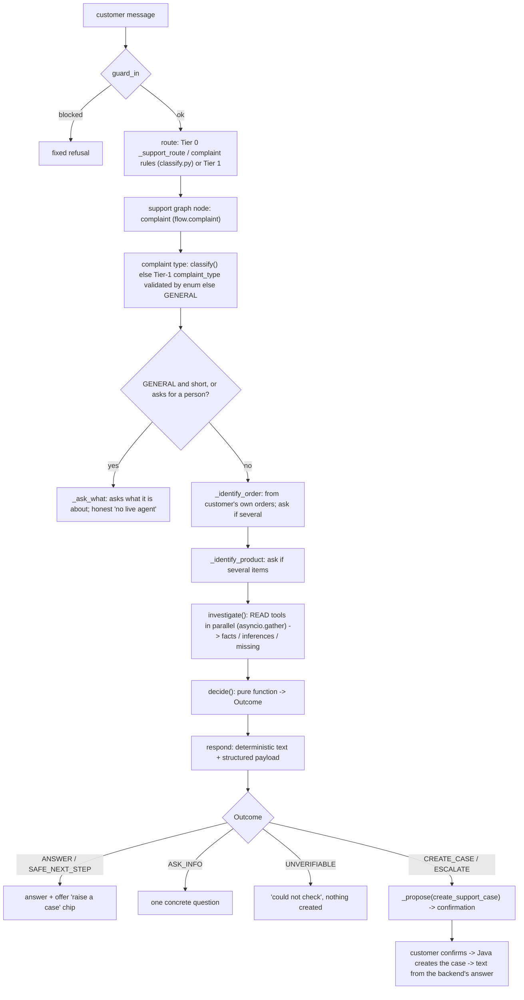

# 11. Phase 3: Customer support and case resolution

Design record: `docs/adr/ADR-011-customer-support-resolution.md`; Phase 3 docs: `docs/ai/phase3/` (final report: `14-final-report.md`). **Honest summary:** a real, persisted, owner-scoped case system exists in Java; the assistant investigates a complaint from the customer's own records, decides with deterministic rules, and (after confirmation) creates and tracks a real case. It cannot resolve, refund, assign or re-prioritise anything, cannot assess photos, cannot contact a carrier or warehouse, and cannot connect a live agent. Sample policies and thresholds are demo values; **no official SLA exists or is claimed**.

## 1. Java: persistent case model (`backend/support`, migration V44)

Tables (forward-only, applied to the real `dsports` database): `support_cases` (the aggregate; unique `case_number` from `support_case_seq`, unique `(user_id, idempotency_key)`, `@Version`, CHECK `ck_support_resolved_has_outcome`), `support_case_messages` (an `internal` flag; CHECK internal -> STAFF author), append-only `support_case_events` (doc 12).

Domain rules in `SupportCase` (`backend/support/.../SupportCase.java`):
* creation: `open` (120-130): subject 1-200, description 1-2000, idempotency key 1-100; an `escalationReason` at creation means escalation state `REQUESTED` (a request), never `ACCEPTED`;
* status: `changeStatus`, `resolve` (outcome + note + staff id), `reopen` (customer only within `app.support.reopen-window`, default `P7D`; staff any time), all through the transition table (doc 03 section 7, `CaseStatus.java:23-35`);
* escalation: `requestEscalation` (idempotent; unresolved only), `assign`: a staff member **taking** an escalated case turns `REQUESTED` into `ACCEPTED` and starts the investigation (201-220);
* customer messages are rejected on a resolved case (reopen first) and end a wait for the customer (223-234).

## 2. Java: use cases and API

| Endpoint | Use case | Behaviour |
|---|---|---|
| `POST /api/v1/support/cases` (`Idempotency-Key` required) | `CreateSupportCaseUseCase.execute @ ...:65-133` | transaction -> advisory lock on `(user,key)` -> if the key exists: `REPLAYED` (same request) or 409 `IDEMPOTENCY_KEY_REUSED`; else verify the order/payment/return belong to the user (404 otherwise), verify the product is in the order, look for an unresolved case of the same category about the same order (`ALREADY_OPEN`, no second case), else persist: case number `CASE-yyyyMMdd-nnnnnn`, priority from `PriorityPolicy`, **backend-verified evidence** snapshot (order, shipment, payments) + submitted evidence stamped `AI_INVESTIGATION` or `CUSTOMER` (**a caller can never claim `BACKEND_VERIFIED`**, lines 109-113), events and the first message |
| `GET /api/v1/support/cases[?unresolved=]`, `GET /{ref}` | `CustomerCaseUseCase` | only the caller's cases; another customer's = `404 CASE_NOT_FOUND`, identical to missing |
| `POST /{ref}/messages`, `/escalate`, `/reopen` | `CustomerCaseUseCase` | transactional; events written in the same transaction |
| `GET/POST /api/v1/support/staff/...` (`cases`, `cases/{ref}`, `assign`, `notes`, `replies`, `status`, `resolve`, `analytics`) | `StaffCaseUseCase` | `SUPPORT_EXECUTIVE` or `ADMIN` (HTTP rule + `@PreAuthorize`); internal notes are stored `internal=true` and never appear in customer views |

Priority (`PriorityPolicy.evaluate @ ...:30-55`, "demo rules, NOT an official DSports SLA or policy"): base by category (GENERAL, EXCHANGE_REQUEST, PRODUCT_COMPLAINT = LOW; most others MEDIUM; DUPLICATE_PAYMENT = HIGH only when the backend itself counted more than one successful payment); +1 level for an order total at or above `app.support.high-value-threshold` (default 10000); +1 level for a repeat contact about the same order; `URGENT` when the explicit `safetyRelated` flag is set (never inferred from tone). Each applied rule is stored as a reason (staff-only).

Optimistic locking: `@Version` on the entity (`SupportCaseEntity.java:81`) and an optional `expectedVersion` on every staff mutation (`StaffCaseUseCase.change @ ...:124-132`); a stale version is a 409 (`OPTIMISTIC_LOCKING_CONFLICT`), and a concurrent writer is caught at save (adapter line 99). The staff UI always sends the version it loaded.

Ownership of related records: `SupportContextPort` is implemented in `SupportModuleConfig` (lines 43-71) by looking up the order **filtered by the user id** and attaching shipment and payment facts; payments/returns are checked with `paymentBelongsTo` / `returnBelongsTo`.

Staff analytics (`StaffSupportController.analytics`, 103-135) are derived only from stored cases (definitions in doc `docs/ai/phase3/09`). `automaticallyResolved` is **always 0**; no SLA, first-response time or satisfaction metric is computed.

## 3. Python investigation workflow (all of it in `ai-service/app/support/`)



### 3.1 Intent classification and context (rules first)
* Complaint type: `classify @ app/support/classify.py:103-161`, ordered rules from specific to general (payments first so "charged twice" is not read as a delivery complaint; delivered-not-received; partial; not arrived/delayed; wrong/damaged/defect/mismatch/manual; refund partial/delayed; return rejected/blocked/pickup; general; "wants a person"). Hypothetical policy questions ("What should I do if my order is damaged?") without first-person experience words are **not** complaints (`_HYPOTHETICAL`/`_EXPERIENCE`, lines 96-97, 115-116); status questions such as "Is my payment pending?" stay Phase 1 answers (`_STATUS_QUESTION`, 100-108).
* Safety flag: `safety_flag` (86-88): explicit vocabulary (injury, fire, hazardous, ...) or an explicit injury to a person; **tone and complaint history are never used** (docstring 78, 87).
* Case verbs and follow-ups in Tier 0: `_support_route @ app/router/tier0.py:208-` with `_CASE_REF`, `_CASE_LIST`, `_CASE_STATUS`, `_CASE_REOPEN`, `_CASE_MESSAGE`, `_CASE_ESCALATE`, `_RAISE_IT` (answers a waiting confirmation: "please raise it"), `_CORRECTION` ("It was the running shoes..."). If no rule fits, Tier 1 may return `COMPLAINT` with `complaint_type` (validated against `Complaint`).
* Conversation context: `conv.slots["support"]` stores `type, stage, order_id, order_number, product_id, description, case_number, ...` with stages `awaiting_order | awaiting_product | awaiting_details | investigated | case_proposed | case_open | awaiting_case_message` (`flow.py:43-52`). A short follow-up like "the running shoes" is routed as a correction/answer using this stage (`tier1.context_block`, line 102-104).

### 3.2 Context gathering (`investigate.investigate @ investigate.py:90-156`)
READ tools for the complaint type, run in parallel with the per-request budget (the `jobs` dictionary, lines 113-140): delivery -> `track_order` + `get_payment_status`; payment -> `get_payment_status` (+ `get_orders` when no order was named); refund -> `get_refund_status` + `get_return_status` + `get_payment_status`; returns -> `get_return_status` (+ `check_return_eligibility`); product line -> `track_order` + `check_return_eligibility` (+ `get_product`, `get_product_reviews` for defects); always `search_support_policy` with a complaint-specific question (`POLICY_QUESTION`, 26-46). A failed lookup is recorded in `inv.unverified`, **never replaced by a guess** (`Gatherer.call`, 68-74).

### 3.3 Evidence: verified vs inferred vs missing (`model.py:65-117`)
* `Fact(kind, statement, ref, source)` with source `DSPORTS_API | POLICY | ACTION_RESULT | CUSTOMER`: read from the customer's own records this turn.
* `Inference(statement, basis)`: always a possibility and says what it rests on.
* `Missing(item, why)`: what could not be verified (e.g. "Proof of delivery (signature, photo or handover record)", `investigate.py:255-256`).
* `signals`: machine flags the decision reads (never the model).
Examples of real logic: stalled shipment = no tracking event for at least `AI_SUPPORT_STALL_DAYS` (default 3, a demo threshold stated in the fact text, lines 232-238); "delayed" plus "marked delivered" becomes `MISSING_DELIVERY` (247-248); a `DELIVERED` shipment always yields the missing-proof entry because the shipment API exposes no proof (254-258); several successful payments for one order are `duplicate_confirmed` (321-324); a successful payment with a CANCELLED/PENDING_PAYMENT/FAILED order is `payment_order_mismatch` (325-327); an approved return with no refund is `approved_no_refund` (386-390).

### 3.4 Deterministic resolution (`resolve.decide @ resolve.py:53-177`)
Outcomes (`model.Outcome`, 120-128): `ANSWER`, `ASK_INFO`, `SAFE_NEXT_STEP`, `CREATE_CASE`, `ESCALATE`, `PERFORM_ACTION` (declared; **no rule currently produces it**: `NOT IMPLEMENTED` as an executed step), `UNVERIFIABLE`. Highlights: a failed critical lookup -> `UNVERIFIABLE` ("I won't guess. Nothing was created", `CRITICAL_LOOKUPS`, line 16); delivered but not received -> `ESCALATE`; stalled/ETA passed -> `CREATE_CASE`; confirmed duplicate or payment/order mismatch -> `ESCALATE` ("I can't reverse a payment myself"); no captured payment for a claimed debit -> `CREATE_CASE` with the bank-statement item listed as missing; return approved without refund -> `ESCALATE` ("I can't issue a refund myself"); a rejected return -> `ESCALATE` as a dispute, never overturned; wrong size -> a return if eligible plus an honest "DSports has no exchange function"; damaged/wrong/defective -> `CREATE_CASE` with the return offered if eligible; a safety concern upgrades any answer/step/ask to `ESCALATE` with a "stop using the product" warning (`_d`, 34-44); a customer who disputes or asks for a person always gets an `ESCALATE` case (`decide`, 53-60).

### 3.5 Requesting more information, case creation, escalation, no live agent
* More info: `_ask_what` (flow.py:143-151) asks "What is it about?" with four tappable examples; `_ask_which_order`/`_identify_product` offer **server-owned choices** (`add_action` creates an offer id the service later resolves; a forged `choiceId` does nothing, test `test_a_forged_choice_id_does_nothing`).
* Case creation: `respond_to` (100-140) builds `create_support_case` arguments from the investigation (`respond.case_arguments`, 74-86: category map, subject, description, deterministic summary, evidence list, policy citations, missing information, recommendation, escalation reason) and `_propose`s it. **Nothing exists until the customer confirms.** After confirmation the text is built only from what the backend returned (`created_text`, `respond.py:103-113`), e.g. "Your support case CASE-... has been created ... A person has been asked to review it, but nobody has taken the case yet ... I don't have an official response-time commitment to quote".
* Later status: `case_status` reads the live case (`get_support_case`) and states status meaning, priority, escalation honesty and the latest support message (`case_status_text`, 116-134).
* Honest about agents: "I can't connect you to a person live, but I can open a support case and ask for a person to review it." (`flow._ask_what`, `resolve._decide` line 72). There is no live-chat or handover integration (`NOT IMPLEMENTED`).

## 4. Customer and staff UI
Doc 04 section 6: `SupportChatBlock` (`InvestigationEvidence`, `ResolutionSummary`, case card/list), `/support`, and the staff console `/support-cases` with version-checked actions and analytics labelled with definitions.

## 5. End-to-end sequence for a customer complaint (Journey C)

```mermaid
sequenceDiagram
  participant U as Customer (browser)
  participant A as AI service
  participant J as Java backend
  participant S as Staff (browser)
  U->>A: POST /v1/chat "My order says delivered but I did not receive it" (JWT)
  A->>A: guard_in ok; Tier 0 rules -> COMPLAINT / MISSING_DELIVERY
  A->>J: GET /api/v1/orders (customer's token) -> identify the order
  par parallel READ tools
    A->>J: GET /api/v1/shipments/by-order/{id}
    A->>J: GET /api/v1/payments/history
    A->>A: search_support_policy (embedding + pgvector)
  end
  A->>A: assess -> facts (DELIVERED, no proof) ; decide -> ESCALATE
  A-->>U: investigation + "Please confirm: Open a support case..." (pending token)
  U->>A: POST /v1/confirm {token}
  A->>A: redeem token, revalidate, audit
  A->>J: POST /api/v1/support/cases (Idempotency-Key ai-<nonce>)
  J->>J: lock, ownership checks, BACKEND_VERIFIED evidence, priority, events
  J-->>A: 201 CREATED CASE-... status OPEN, escalation REQUESTED
  A-->>U: "Your case CASE-... ... nobody has taken it yet"
  S->>J: POST /api/v1/support/staff/cases/{ref}/assign {takeIt:true}
  J->>J: escalation REQUESTED -> ACCEPTED, status -> INVESTIGATING, events
  U->>A: "What happened to my complaint?"
  A->>J: GET /api/v1/support/cases (latest) / {ref}
  A-->>U: live status: INVESTIGATING, "A support executive has taken the case"
```

Branches that actually exist: `ANSWER`, `ASK_INFO`, `SAFE_NEXT_STEP` (return offer), `CREATE_CASE`, `ESCALATE`, `UNVERIFIABLE`, plus `ALREADY_OPEN` and `REPLAYED` from Java. Not supported (and said so): resolving, refunding, cancelling, reversing payments, exchanges, photo assessment, carrier/warehouse contact, delivery proof, live agent handover, email/SMS notifications.

## 6. Security, injection and unauthorized-access protections
* Input guard: `_CROSS_CUSTOMER`, `_NAMED_PERSON`, `_OTHERS_CASES`, `_INTERNAL_INFO`, `_STAFF_ACTION` (`app/guard/input.py:24-54`) refuse requests to see other customers' cases, internal notes/priority logic, or to close/resolve/refund/cancel/reassign/re-prioritise **before any tool runs**.
* Tools: no identity argument; `CaseRefArgs` validates the case reference shape (path traversal characters cannot reach the URL); WRITE tools need the confirmation service; customer text is stored as the customer's statement and **never executed** (`test_a_complaint_text_is_stored_as_the_customers_statement_and_is_never_executed`); a poisoned policy document is data (`test_a_poisoned_policy_document_is_treated_as_data_and_cannot_trigger_anything`).
* Java: ownership (404 uniform), role gate on staff routes, customer DTO has no internal notes or priority reasons (`test_the_customer_view_of_a_case_never_carries_staff_only_fields`; Java `internal_notes_never_reach_the_customer_and_staff_see_them`).
* Retrieval: `sup_*` internal documents excluded from customer retrieval in SQL (`test_support_documents_db.py`, 5 tests).

## 7. Failure scenarios and test evidence

| Scenario | Behaviour | Test |
|---|---|---|
| support API down | no case number is ever invented | `test_when_support_is_down_no_case_number_is_ever_invented` |
| order records unreachable | "could not check", nothing created | `test_when_the_order_records_are_unreachable_...` |
| backend returns garbage / is slow | reported without inventing; clean timeout | `test_a_malformed_backend_answer_...`, `test_a_slow_backend_times_out_cleanly` |
| tool budget too small | degrades to "could not check", never a guess | `test_a_tight_tool_budget_degrades_...` |
| replayed confirmation / second complaint | no second case | `test_a_replayed_confirmation_creates_no_second_case`, `test_a_second_complaint_about_the_same_order_does_not_create_a_second_case` |
| eight concurrent submissions with one key | exactly one case | Java `eight_concurrent_submissions_of_one_key_create_exactly_one_case` |
| stale view / concurrent writers | rejected / one wins | Java `a_stale_view_is_rejected_and_concurrent_writers_cannot_both_win` |
| DB refuses RESOLVED without outcome | constraint | Java `the_database_itself_refuses_a_resolved_case_without_an_outcome` |

Counts: Python `tests/support/` 76 test functions across 6 files (parametrised cases add more; 164 tests ran in the `sup-unit` step together with parametrisation), live `tests/live/test_stack_support.py` 11, Java support 20 unit + 14 integration, browser `e2e/support-ui.mjs` 23 steps, evaluation dev 45 / held-out 24 (doc 14).

## 8. What cannot be investigated (current limitations)
No photo/image assessment; no carrier, warehouse or proof-of-delivery data; no bank statement visibility; exchanges do not exist in DSports; a true double charge cannot occur in the current schema (`uq_payments_order_open`), so the confirmed-duplicate branch is exercised by unit tests only (the live evaluation uses "two attempts, one captured"); thresholds (stall days, high-value, reopen window) are demo configuration; the 15-minute JWT can expire during very long evaluations.
