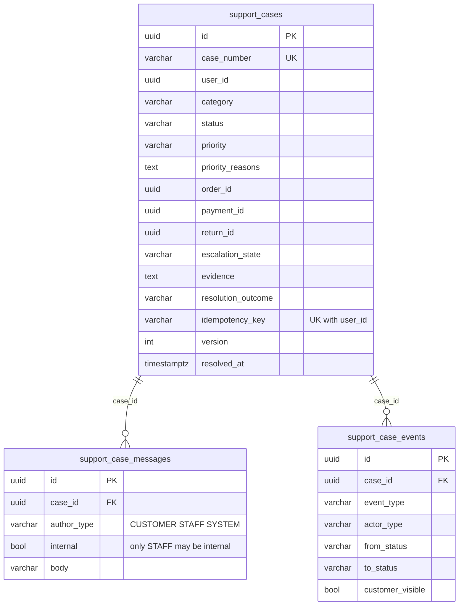
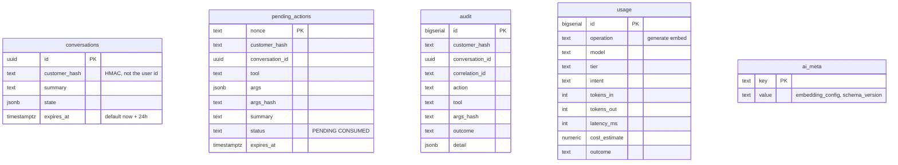
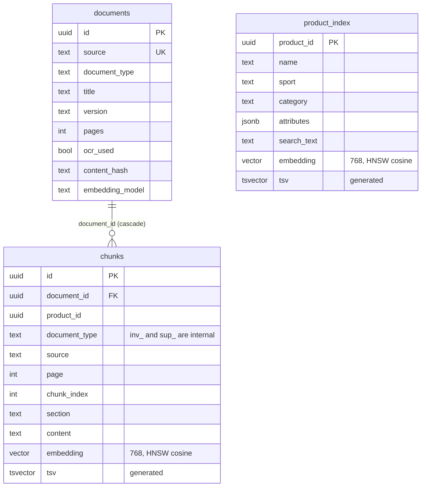

# 12. Database and data lifecycle

No passwords, tokens, connection secrets or customer personal data appear in this document. Entity-relationship diagrams below are drawn **only** from schema definitions that were read in the repository (support V44, return requests V40, refunds/payments V35 constraints, AI schema files, inventory mart schema).

## 1. Who owns which database

| Database | Owner / writer | Schema tooling | Created by |
|---|---|---|---|
| `dsports` | Java backend (R2DBC at runtime, Flyway at startup) | Flyway V1-V44, forward-only (`spring.flyway.locations: classpath:db/migration`, `application.yml:29-34`) | docker-compose (`POSTGRES_DB: dsports`) |
| `dsports_ai` | Python AI service (asyncpg) | idempotent `CREATE ... IF NOT EXISTS` SQL applied at startup by `Store.ensure_schema` (`ai-service/app/store/db.py:37-43`; files `schema.sql`, `schema_rag.sql`, `inventory/schema_inventory.sql`), guarded by `pg_advisory_xact_lock(7_020_001)` | `ai-service/db/init-ai-db.sql` (`CREATE DATABASE dsports_ai OWNER dsports`, run on a fresh volume, or manually on an existing one) |

The two databases live in the same PostgreSQL container (`pgvector/pgvector:pg16-trixie`, `docker-compose.yml:4`) but are separate databases: there are no cross-database joins and the AI service never reads Java tables directly (it uses the REST APIs). The real `dsports` database is never dropped or recreated by validation (Testcontainers and `dsports_e2e_val` are used for destructive runs).

## 2. Java business tables (`dsports`), by module

| Module | Tables (from the migrations) |
|---|---|
| identity | `customers`, `customer_roles`, `customer_auth_providers`, `refresh_tokens`, `customer_addresses` |
| catalog | `sports`, `categories`, `brands`, `products`, `product_images`, `product_attributes` (V39) |
| inventory | `inventory`, `inventory_reservations` (V32) |
| pricing | `prices` |
| cart / checkout | `carts`, `cart_items`, `checkouts`, `checkout_items` |
| order | `orders`, `order_items`, sequence `order_number_seq` (V34) |
| payment | `payments`, `payment_audit`, `refunds` (V35) |
| shipment | `shipments`, `shipment_tracking` |
| returns | `return_requests` (V40) |
| review / wishlist / notification | `reviews`, `review_helpful_votes`, `wishlists`, `wishlist_items`, `notifications`, `notification_templates` |
| platform | `outbox_events` (V33, bootstrap) |
| support | `support_cases`, `support_case_messages`, `support_case_events`, sequence `support_case_seq` (V44) |

Seeding: V8-V10 sports/categories/brands; V15-V17 products, inventory, prices; V41-V43 enrichment, INR prices and the multisport demo catalogue (134 products). These are demo/sample data (`SYNTHETIC / POC DATA` for products and prices).

### Support tables (V44, verified)

Database-level guards (V44): `ck_support_status`, `ck_support_priority`, `ck_support_escalation`, `ck_support_category`, `ck_support_resolved_has_outcome` (`(status='RESOLVED') = (resolution_outcome IS NOT NULL AND resolved_at IS NOT NULL)`), `ck_support_internal_is_staff`, `uq_support_case_number`, `uq_support_case_user_key`. `order_id`, `payment_id`, `return_id`, `product_id` are plain UUID columns **without foreign keys** to the other modules' tables (module isolation; ownership is checked in the use case through `SupportContextPort`). Indexes: `(user_id, updated_at DESC)`, `status`, `(user_id, order_id)`, `assigned_to`, and per-case message/event indexes.

### Returns and payments (verified fragments)
`return_requests`: `status IN ('REQUESTED','APPROVED','REJECTED')`, `quantity > 0`, unique `(user_id, idempotency_key)`, indexes on `(order_id, product_id)`, `(user_id, created_at DESC)`, `status` (V40). Payments: partial unique index `uq_payments_order_open ON payments(order_id) WHERE status IN (CREATED, PENDING, PROCESSING, AUTHORIZED, SUCCESS, PARTIALLY_REFUNDED, REFUNDED)`, `ck_payment_amount_positive`, `ck_payment_refunded_within_amount` (V35); `refunds.payment_id` references `payments(id)` (V35).

## 3. AI database tables (`dsports_ai`)

### Core AI state (`ai-service/app/store/schema.sql`)

No foreign keys connect these tables (they are independent logs/state). The token itself is never stored, only its nonce (`schema.sql:62`).

### RAG (`schema_rag.sql`)

Architecturally important indexes: HNSW (`vector_cosine_ops`) on `chunks.embedding` and `product_index.embedding`; GIN on both `tsv` columns; `(document_type, sport, category)` for the metadata filters used inside both retrieval queries.

### Inventory Intelligence mart (`schema_inventory.sql`, all `SYNTHETIC / POC DATA` or labelled reference)
Reference/dimension: `inv_sku` (price from DSports live; cost, supplier, lead time, MOQ, case pack are POC reference), `inv_region`, `inv_event`. Facts: `inv_demand_daily` (PK `(product_id, region, day)`), `inv_stock_snapshot`, `inv_position` (current planning position, FIFO age), `inv_purchase_order`. Model outputs (rebuildable, versioned by run): `inv_model_run` (`is_current`), `inv_forecast` (daily mean/lo/hi arrays, WAPE), `inv_event_impact`, `inv_elasticity`, `inv_assessment` (per product and scenario `BASELINE` or `EVENT:<id>`: cover, stock-out date, probability, safety stock, reorder point, risk level, reorder quantity, order-by, excess, health class), `inv_region_share`. Logs: `inv_scenario_run`, `inv_audit` (`TRAIN|FORECAST|SCENARIO|QUERY|SEED|DENIED`), `inv_dq_report`. Every data row has `data_source`.

## 4. Identifiers and relationships
* Customers are `UUID` in Java; the AI service references them only as `customer_hash = HMAC-SHA256(AI_CUSTOMER_HASH_KEY, user_id)[:32]` (`customer_hash @ ai-service/app/auth/jwt.py:40-42`), so AI logs, audit and usage cannot be joined back to a user without the key.
* Products are UUIDs shared by Java `products.id`, AI `product_index.product_id`, `inv_sku.product_id` and `chunks.product_id` (no FK across databases).
* Order numbers (`ORD-YYYYMMDD-NNNNNN`) and case numbers (`CASE-YYYYMMDD-NNNNNN`) are human-facing; the assistant validates their shape before using them.

## 5. Data lifecycle and cleanup
* **Conversations:** `expires_at` = save time + `AI_CONVERSATION_TTL_H` (24 h); expired rows are ignored by queries (`... AND expires_at > now()`, `PgStateStore.load`, `state.py:134-135`). **No job that deletes expired conversations, consumed/expired `pending_actions`, `audit` or `usage` rows was found** in `ai-service/app` (the index `ix_conversations_expiry` exists, a cleanup consumer does not): `PARTIALLY IMPLEMENTED` retention; growth is unbounded in a long-running deployment.
* **Pending actions:** single-use, expire after `AI_CONFIRMATION_TTL_S` (300 s); outcomes recorded via `finish_pending`.
* **RAG data:** rebuildable (`ingest-corpus` idempotent by content hash; `reindex`; document `remove`).
* **Inventory mart:** `seed` truncates and reloads every `inv_*` data table in one transaction; `train` creates a new versioned run and flips `is_current`; reading never retrains.
* **Java:** orders unpaid for `PT30M` are cancelled by the scheduled job; support events are append-only; migrations are forward-only.

## 6. Data isolation and authorization boundaries
* Customer isolation for business data is enforced in Java use cases (ownership filters); for AI state by `customer_hash` in every conversation/pending query (`WHERE ... AND customer_hash=$2`).
* `chunks.document_type` prefixes `inv_`/`sup_` separate internal documents; the filter is in SQL (doc 07).
* Inventory tables are reachable only through ADMIN-gated endpoints/tools.
* Support internal notes: `support_case_messages.internal = true` rows are excluded by `repository.messages(caseId, false)` for customers (`CustomerCaseUseCase.get`, line 45-46).
