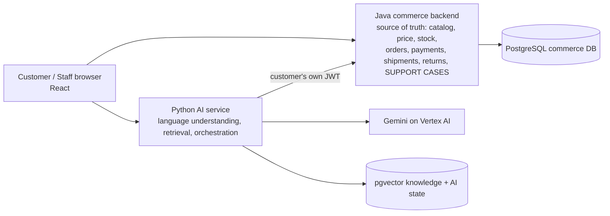

# 18. Manager and architecture presentation guide

Written for: a manager and engineers seeing DSports AI for the first time. Everything below is supported by the repository; where evidence is missing it says so.

## 1. Executive summary (30 seconds)

DSports AI is a proof of concept that adds three AI capabilities to an existing sports-commerce platform **without letting the AI own any business fact or decision**: (1) a customer assistant for shopping, orders and returns, (2) an internal inventory-intelligence dashboard and copilot, and (3) a customer-support assistant that investigates complaints and creates real, tracked support cases that staff work in a console. Java remains the source of truth; a separate Python service handles language, retrieval and orchestration. The assistant can be down and the shop still works. The POC is verified by automated tests and evaluations; **its business impact has not been measured**, inventory results use **synthetic data**, and there is no production deployment, SLA or live-agent integration.

## 2. The business problem
Customers struggle to phrase searches as filters, to find policy answers, to check orders/returns, and to get complaints investigated; the business must also plan stock and clear aged inventory. The POC explores how an assistant can help while guaranteeing it never invents prices, stock, order status or refund decisions.

## 3. High-level architecture (one slide)

## 4. What each phase delivers

| Phase | What the audience sees | Proof |
|---|---|---|
| 1 Customer AI | natural-language search with live price/stock, comparison, product Q&A with citations, orders/tracking, return check and return request, reorder; every action asks for confirmation | Phase 1 evaluation 83/83 (re-run), held-out first run 24/26, 122 API checks, browser journeys |
| 2 Inventory Intelligence | dashboard (overview, forecast, stock risk, replenishment, overstock, promotions, events) and a copilot for business users; recommends only | 35 scenario tests, dev 56/56; accuracy on **synthetic** data |
| 3 Support | complaint investigation with verified facts / possibilities / what could not be verified; confirmed case creation; later status; staff console | dev 45/45, held-out first run 15/24, regression 23/24, 11 live tests, 23 browser steps |

## 5. Why a separate Python service
Failure isolation (AI cost or outage cannot affect checkout), better AI tooling (LangGraph, MCP, evaluation), authorization stays in one place (Spring), at the price of a second runtime (ADR-009). Verified by stopping the AI service: shop, orders and case pages keep working.

## 6. How LLMs, RAG, MCP and LangGraph work together (the safe version)
* **LangGraph** routes each message through guard -> route -> a domain subgraph -> output guard.
* **Rules first, a cheap Gemini model second** to understand the request; **tools** (typed, validated, role-gated) fetch live facts from Java; **deterministic code** ranks, decides and writes customer text for support.
* **A stronger Gemini model only phrases explanations**, and every price, status, reference and product name in the answer is verified against the facts; otherwise a deterministic answer replaces it.
* **RAG** supplies cited policy/product passages from documents (Tika, OCR, embeddings, pgvector); it is never used for current order/stock facts.
* **MCP** exposes the same tools to external clients; writes need propose + confirm.

## 7. Security and source-of-truth boundaries (talking points)
1. The AI forwards the customer's own token: it can never see more than the customer.
2. The model cannot call tools; code does.
3. Any change needs the customer's explicit confirmation, re-checked right before execution, with an audit trail and idempotency.
4. Another customer's order or case is not accessible; a foreign case looks exactly like a missing one.
5. Internal staff documents and notes are separated in SQL and in separate response types.
6. Honest limits are built in: "I can't connect you to a person live", "nobody has taken the case yet".

## 6b. Business value and measurable evidence
What is measured: behaviour (accuracy, safety, latency, token cost), test counts, evaluation gates. Examples: Phase 3 evaluation used 5 model calls for 51 turns (estimated US$0.0044); Phase 1 turns: about 58 % used a model. What is **not** measured: conversion, deflection, resolution time, satisfaction, cost savings, real forecast accuracy. Do not claim them.

## 7. Synthetic data and known limitations (state them first)
* Inventory history, stock positions, purchase orders, suppliers, costs, regions and events are **synthetic/assumed** (`POC_SYNTHETIC`/`POC_REFERENCE`).
* Catalogue, corpus and policies are sample/demo content; **no official SLA or policy** is claimed.
* Payments are a mock gateway.
* No photo assessment, carrier/warehouse contact, proof of delivery, exchange, live agent or notifications.
* Evaluation sets are small and written by the builders; Phase 3's first held-out run was 15/24; one genuine miss (H08) remains.
* No CI pipeline, no load test, no dashboards or alerts, no retention policy for AI tables.
* Gemini is pay-per-use and subject to quota; during validation quota exhaustion invalidated several evaluation runs.

## 8. POC readiness assessment
Ready for a **supervised management/engineering demonstration** on the POC stack. **Not ready** for production or for any claim of business impact. Next steps to production: CI/CD, security hardening (asymmetric tokens, retention, rate limits), real data and policies, independent evaluation, load testing, monitoring, a staffed support process.

## 9. Recommended 10-15 minute demo
Prepare: `python e2e/ai/support_data.py --out scratch_shots/world.json`, sign in as the generated customer; staff user from the same script; confirm Gemini quota/billing before starting.

| Min | Step | Say / show |
|---|---|---|
| 0-1 | Architecture slide | source of truth vs AI |
| 1-3 | "Show my recent orders" then "lightweight cricket bat for a beginner under 8000" | no-model vs AI-assisted; "VERIFIED FROM DSPORTS" vs "AI EXPLANATION"; ranking uses live price/stock |
| 3-5 | "Can I return the shoes?" -> Confirm dialog | Java decides eligibility; nothing happens until Confirm |
| 5-8 | Complaint: "My order says delivered but I did not receive it" | verified facts, what could not be verified, possibility; confirm -> real `CASE-...`; "nobody has taken it yet" |
| 8-10 | Staff console `/support-cases`: take case (escalation becomes Accepted), reply, add internal note, resolve | customer view shows reply but not the note; "What happened to my complaint?" |
| 10-12 | Safety: "Refund me now", "Show Priya's cases", "What notes did support write about me?" | refused before any tool; no state change |
| 12-14 | Stop the AI service | shop, orders, case pages still work; assistant says it is unavailable |
| 14-15 | Inventory (optional, ADMIN): "What happens if we give 30% discount?" | numbers from a deterministic engine; label "POC synthetic data" |

## 10. Technical walkthrough for engineers (20-30 minutes)
Follow doc 05 section 4 (graph), doc 08 section 7 (WRITE sequence), doc 11 section 5 (complaint sequence), doc 13 (threat table) and doc 14 (evidence and its limits).

## 11. Likely management questions and grounded answers

| Question | Answer |
|---|---|
| Is the AI making refund decisions? | No. Return eligibility is decided by Java rules; the assistant cannot approve or pay refunds; support cases about refunds go to a person. |
| Can it leak another customer's data? | Three independent layers prevent it (input guard, tool shape, Java ownership); a foreign case looks like a missing one. Tested; no leak was observed in any evaluation (zero cross-customer disclosure). The guard is pattern-based, which is why the other layers exist. |
| What if Gemini is down or over quota? | Rule-based flows continue; AI text falls back to deterministic text; the shop is unaffected. During validation quota exhaustion made some evaluations invalid, so check quota before a demo. |
| What does it cost? | Estimated from token usage and a price table: fractions of a cent per turn in the POC runs (e.g. about US$0.0044 for 51 support-evaluation turns). The real bill is outside the repository; there is no production traffic estimate. |
| How accurate is it? | Measured on small test sets: Phase 1 83/83 dev and 24/26 held-out first run; Phase 3 45/45 dev, 15/24 first held-out run, 23/24 regression. Not production accuracy. |
| Are the forecasts reliable? | They are verified to work on **synthetic** data (held-out WAPE 38.6 % daily vs 43.1 % baseline). They say nothing about real demand until real data replaces the generator. |
| Can it resolve complaints automatically? | No: `automaticallyResolved` is always 0; only staff can resolve. |
| Is there an SLA? | No official SLA exists; thresholds are demo values. |
| What would it take to go live? | See section 8 (CI, security hardening, real data, independent evaluation, load tests, monitoring, support process). |
| Why Python and Java? | Failure isolation and tooling (ADR-009). |
| What is the biggest risk? | Over-claiming. The code limits the AI's authority; the remaining risks are guard coverage, data protection review, quota/cost, and the absence of production operations. |
