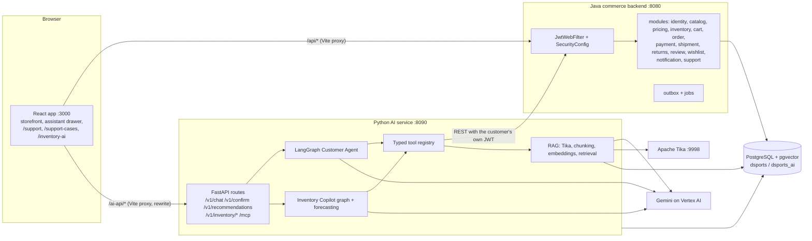
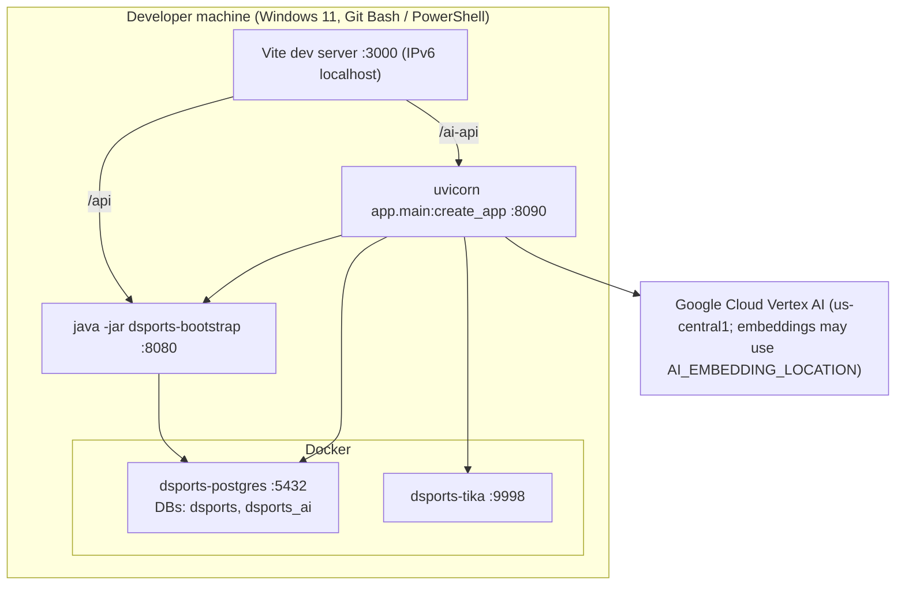
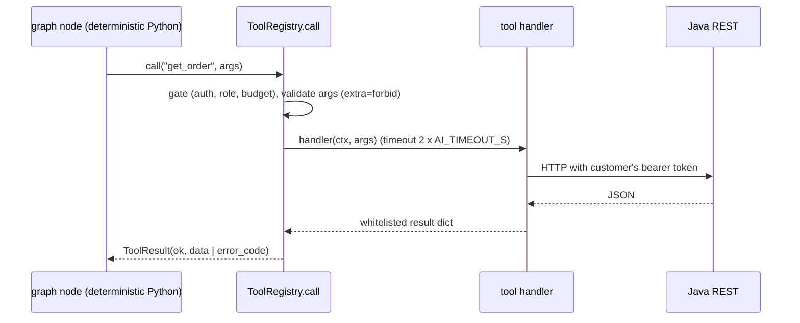
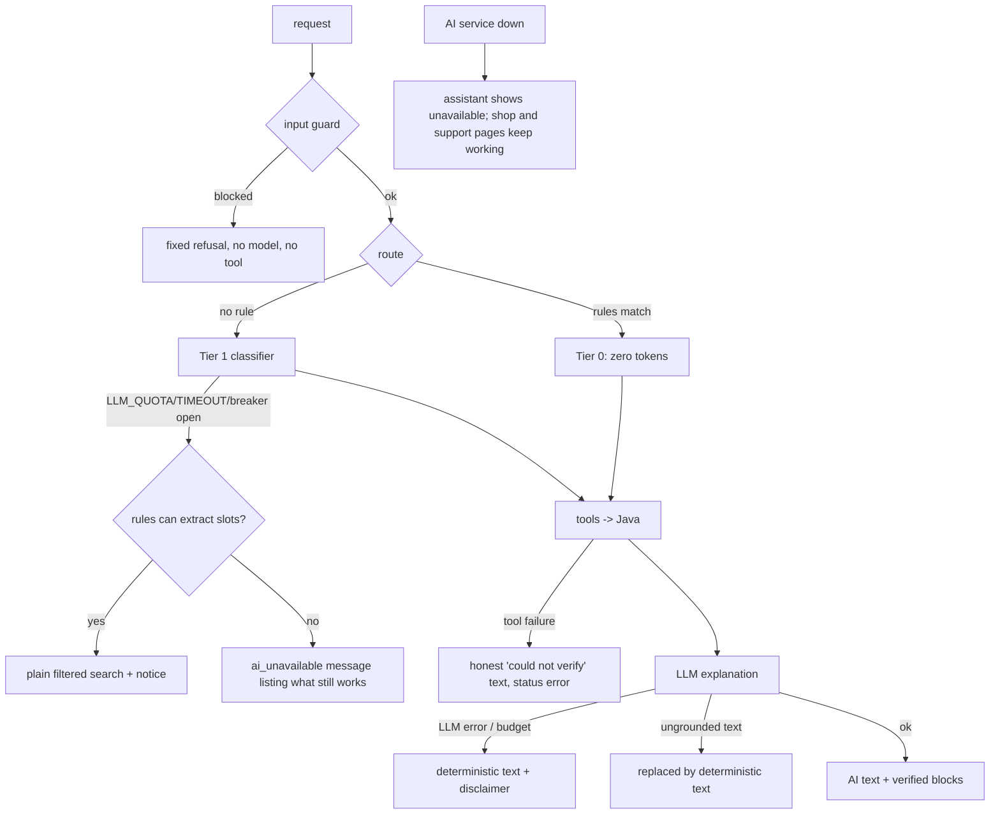

# 02. Complete system architecture

Status labels used in this guide: `IMPLEMENTED`, `TESTED`, `VERIFIED`, `PARTIALLY IMPLEMENTED`, `PLANNED`, `NOT IMPLEMENTED`, `SYNTHETIC / POC DATA`, `UNKNOWN`.
Source references look like `symbol @ path:start-end` (line numbers verified against the files at the time of writing; see [DOCUMENTATION-COVERAGE.md](DOCUMENTATION-COVERAGE.md)).

## 1. The components

| Component | Technology | Port / location | Owns | Status |
|---|---|---|---|---|
| Storefront and internal consoles | React 19 + TypeScript + Vite + MUI + Zustand + TanStack Query | `:3000` (dev) | nothing persistent (browser `localStorage` for tokens) | IMPLEMENTED, VERIFIED |
| Commerce backend | Java 21, Spring Boot 3.4 WebFlux, R2DBC, Flyway, Spring Security | `:8080` | the `dsports` database (V1 to V44) | IMPLEMENTED, TESTED |
| AI service | Python 3.13, FastAPI, LangGraph, MCP SDK, asyncpg | `:8090` | the `dsports_ai` database | IMPLEMENTED, TESTED |
| PostgreSQL + pgvector | `pgvector/pgvector:pg16-trixie` container `dsports-postgres` | `:5432` | databases `dsports` and `dsports_ai` | IMPLEMENTED |
| Apache Tika (+Tesseract OCR) | `apache/tika:latest-full` container `dsports-tika` (profile `ai`) | `:9998` | nothing | IMPLEMENTED |
| LLM | Gemini on Google Vertex AI (`gemini-2.5-flash-lite`, `gemini-2.5-flash`), embeddings `text-embedding-005` (768-d) | Google Cloud | nothing | IMPLEMENTED, VERIFIED (see doc 15 for quota behaviour) |
| MCP server | official `mcp` SDK, streamable HTTP, mounted in the AI service | `:8090/mcp` | nothing | IMPLEMENTED, TESTED |

Sources: `docker-compose.yml:1-61`, `backend/bootstrap/src/main/resources/application.yml:39-41`, `ai-service/app/config/settings.py:12-83`, `frontend/vite.config.ts:13-27`.
Empty or placeholder backend modules: `admin`, `ai`, `billing`, `franchise` contain no Java source (NOT IMPLEMENTED); the Maven `ai` module is an empty placeholder because the AI service is Python (ADR-009).

## 2. High-level component diagram



## 3. Deployment and runtime topology (verified on the development machine)



* Ports and start commands: `e2e/ai/start-backend.sh`, `e2e/ai/start-ai.sh:9` (uvicorn on 8090), `docker-compose.yml`. `e2e/ai/free-port.sh` stops only processes that belong to this project.
* The Dockerfile and compose service for the AI service exist (`docker-compose.yml:34-58`), but the verified runs used the host process; the container path is `PARTIALLY VERIFIED` (UNKNOWN whether it was exercised in the latest runs).
* Deployment to GCP Cloud Run and GitHub Actions are listed in `AGENTS.md` (DevOps) and are `PLANNED`: the baseline audit records that `.github/workflows/` is **empty** (`docs/baseline/06-testing.md:70`), so there is no CI pipeline; no Cloud Run configuration was found. Validation is run by hand with `e2e/validate-all.sh`.

## 4. Service-to-service communication and request propagation

```mermaid
sequenceDiagram
  participant U as Browser
  participant V as Vite proxy
  participant A as AI service
  participant J as Java backend
  participant D as dsports DB
  U->>V: POST /ai-api/v1/chat {message}  (Authorization: Bearer JWT)
  V->>A: POST /v1/chat  (prefix rewritten)
  A->>A: verify JWT (same HS256 secret), build Principal
  A->>J: GET /api/v1/orders  (Authorization: Bearer the SAME JWT, X-Correlation-Id)
  J->>J: JwtWebFilter -> Authentication; use case checks ownership
  J->>D: SELECT ... WHERE user_id = ?
  J-->>A: JSON (only the customer's own rows)
  A-->>U: ChatResponse (structured; verified data + optional AI text)
```

Facts that matter:
* The AI service never has a service account in the Java backend: it forwards the customer's own bearer token (`DSportsClient.request @ ai-service/app/tools/dsports_client.py:32-47`). Java's own ownership checks therefore remain the real authorization boundary.
* `X-Correlation-Id` is generated or accepted in `install_request_context @ ai-service/app/obs/middleware.py:16-39`, forwarded by `DSportsClient`, and printed in Java log lines (`application.yml:90-92`, `CorrelationIdFilter`).
* Both services validate the same HS256 JWT: Java in `JwtWebFilter.filter @ backend/bootstrap/src/main/java/com/dsports/security/JwtWebFilter.java:36-61`, Python in `verify_token @ ai-service/app/auth/jwt.py:45-72`. The Python side accepts the HS256/384/512 family because the Java library picks the strength from the secret length (`jwt.py:22-25`).

## 5. Database ownership and data boundaries

```mermaid
flowchart LR
  subgraph dsports["database dsports (owner: Java, Flyway V1-V47)"]
    C[catalog: sports, categories, brands, products, images, attributes]
    I[inventory + reservations]
    PR[prices]
    CT[cart, checkout]
    O[orders]
    PY[payments, refunds]
    SH[shipments]
    RT[return_requests]
    RV[reviews, wishlist, notifications]
    SC[support_cases, support_case_messages, support_case_events]
    OB[outbox_events]
  end
  subgraph ai["database dsports_ai (owner: Python, created by ensure_schema)"]
    M[ai_meta, conversations, pending_actions, audit, usage]
    R[product_index, documents, chunks (pgvector)]
    X[inv_* analytical mart: sku, demand, positions, POs, events, forecast, assessment, audit ...]
  end
```

Rules:
* The AI database stores only derived or AI-owned data. It holds no price, stock, order or payment value, and customers are referenced by an HMAC hash (`ai-service/app/store/schema.sql:1-3`, `schema_rag.sql:1-2`).
* The only exception that looks like business data is the Phase 2 inventory mart (`inv_*`): it is entirely `SYNTHETIC / POC DATA` (history, stock positions, purchase orders, costs, suppliers, regions), labelled row by row (`schema_inventory.sql:1-6`).
* The `dsports_ai` database is created by `ai-service/db/init-ai-db.sql`; its tables are created by `Store.ensure_schema @ ai-service/app/store/db.py:37-43` (idempotent SQL guarded by an advisory lock), not by Flyway.

## 6. Source of truth, and why the AI must not invent facts

| Fact | Source of truth | The AI service may |
|---|---|---|
| Product, price, stock, rating | Java catalog, pricing, inventory, review modules | read live on every use (`Catalog.live @ ai-service/app/shop/catalog.py:163-174`); cache only public reference data |
| Orders, payments, refunds, shipments | Java order, payment, shipment modules | read with the customer's token; never write directly |
| Return eligibility and returns | `ReturnPolicy.evaluate @ backend/returns/.../ReturnPolicy.java:42-73` | read the verdict; request creation only through a confirmed WRITE tool |
| Support cases, status, escalation | Java `support` module | create/read through REST; never store |
| Product knowledge and policies | documents in the vector store | retrieve and cite; never treat as current facts |
| Demand forecast and stock plan | persisted output of deterministic code (`inv_forecast`, `inv_assessment`) | read and explain; never recompute with an LLM |

Why: an LLM can produce a fluent price, a stock count, a refund promise or a delivery date that is simply wrong, and a customer or the business may act on it. The design therefore (a) fetches facts through tools, (b) lets code decide (ranking, eligibility, decisions, forecasts), (c) lets the model only phrase an explanation, and (d) verifies the phrasing against the tool results before it leaves the service (`check_grounding @ ai-service/app/guard/grounding.py:135-188`, `is_grounded @ ai-service/app/inventory/grounding.py:102-104`).

## 7. AI tool execution (summary; full detail in doc 08)



`ToolRegistry.call @ ai-service/app/tools/registry.py:122-149`. **The LLM never chooses a tool.** Tool calls are made by plain Python in graph nodes after routing (rules or a classifier). The code has no Gemini function-calling configuration (verified by a search for `tools=`, `FunctionDeclaration`, `function_call` in `ai-service/app`: only response metadata matches).

## 8. RAG ingestion and retrieval (summary; full detail in doc 07)

```mermaid
flowchart LR
  F[file: md/pdf/docx/html/png/jpg] --> TK[Tika /rmeta/html]
  TK --> OCR{PDF digital chars/page < 50?}
  OCR -- yes --> O2[Tesseract ran inside Tika; ocr_used recorded]
  OCR -- no --> CL
  O2 --> CL[clean_text]
  CL --> CH[heading-aware chunks 450 tokens / 60 overlap]
  CH --> EM[text-embedding-005, RETRIEVAL_DOCUMENT, batch 16]
  EM --> PG[(documents + chunks vector(768), HNSW, tsvector)]
  Q[question] --> QE[embed_query RETRIEVAL_QUERY, cached]
  QE --> V[vector top-20]
  Q --> KW[OR tsquery top-20]
  V --> RRF[Reciprocal Rank Fusion k=60]
  KW --> RRF
  RRF --> MIN[similarity floor 0.5 or keyword hit]
  MIN --> CTX[fenced untrusted passages with [n] numbers]
```

## 9. Failure and fallback paths



Code: `route_node @ ai-service/app/agent/graph.py:65-94`, `guard_out @ graph.py:121-139`, `_llm_text @ ai-service/app/agent/shopping.py:107-123`, `ResilientLLM._guarded @ ai-service/app/llm/resilient.py:73-89`, UI `fail @ frontend/src/store/aiStore.ts:52-59`.

## 10. Error contract

Both services answer errors in the same shape: `{status, error, code, message, path, correlationId, timestamp, validationErrors?}`. Java: `GlobalExceptionHandler @ backend/bootstrap/src/main/java/com/dsports/exception/GlobalExceptionHandler.java:58-59` and `ApiErrors`; Python: `error_body @ ai-service/app/errors.py:25-38`. The frontend reads it with `getApiError @ frontend/src/api/errors.ts:15-23`. A support-case that belongs to someone else returns `404 CASE_NOT_FOUND`, identical to a missing case (`CustomerCaseUseCase.owned @ backend/support/.../CustomerCaseUseCase.java:100-102`).

## 11. Observability, evaluation and cost components

| Concern | Where | Status |
|---|---|---|
| JSON logs with correlation id | `ai-service/app/obs/logging.py`, `middleware.py` | IMPLEMENTED |
| Prometheus metrics at `/metrics` | `ai-service/app/obs/metrics.py:8-25` | IMPLEMENTED |
| Per-call usage and estimated cost | `UsageRecorder.record @ ai-service/app/obs/usage.py:58-84`, table `usage` | IMPLEMENTED (cost is an estimate from `AI_PRICE_TABLE_JSON`) |
| Java Actuator health/metrics | `application.yml:43-62` | IMPLEMENTED |
| Evaluation harnesses | `ai-service/eval/run_eval.py`, `run_inventory_eval.py`, `run_support_eval.py` | IMPLEMENTED, VERIFIED (doc 14) |

## 12. External dependencies

Google Cloud (Vertex AI). Payment gateway is a mock in the backend (`MockPaymentGateway` in `backend/payment/.../gateway/`), so every payment, capture and refund in this POC is simulated (`SYNTHETIC / POC DATA` for money movement). No carrier, warehouse or email/SMS integration exists (`NOT IMPLEMENTED`; shipments are created and advanced through DSports APIs).
