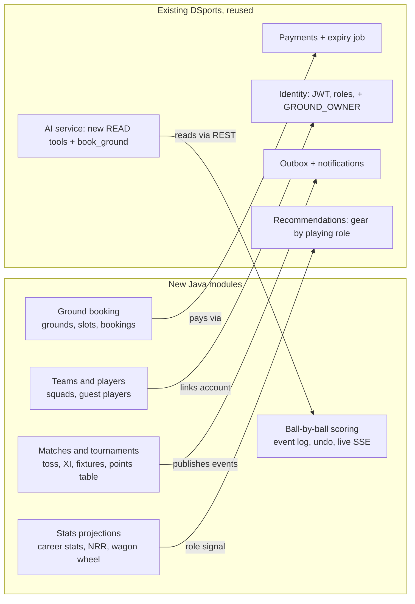

# DSports Cricket Features — Gap Analysis and Build Plan

As of 2026-11-16. Written from the project documentation (AGENTS.md, ARCHITECTURE-OVERVIEW.md,
SETUP-AND-DEMO.md, architecture.md, the learning guide), not from the source code.
Where this plan and the real code disagree, the code wins: report the difference before building.

## Gap analysis

DSports already covers the commerce side of CricHeroes (store, payments, notifications, support, AI assistant). It has none of the cricket-activity side: no teams, matches, scoring, tournaments or grounds. Build 5 new modules, and reuse the existing commerce patterns for booking and payments.

| CricHeroes feature | In DSports today | Action |
| --- | --- | --- |
| Sign-up, login | Yes: JWT auth, refresh tokens, roles | Reuse |
| Player profile (role, batting/bowling style, career stats) | Partial: shopper profile with sport, price range, family members | Extend: new `player` profile linked to the customer |
| Store (gear, apparel) | Yes: catalogue, cart, checkout, orders, returns | Reuse; link gear to player role |
| Payments | Partial: mock gateway, authorise/capture/refund | Reuse for bookings and entry fees |
| Teams and squads | No | **Build** `team` module |
| Start a match (toss, playing XI, rules) | No | **Build** `match` module |
| Ball-by-ball scoring, undo, extras, wickets | No | **Build** `scoring` module |
| Live score for viewers | No | **Build** with server-sent events (WebFlux) |
| Scorecard analytics (wagon wheel, Manhattan, worm) | No | **Build**, computed from the ball log |
| Tournaments (fixtures, points table, NRR) | No | **Build** `tournament` module |
| Book My Ground | No | **Build** `ground` module |
| AI match report, CricInsights | Partial: AI service, grounding check, typed tools | Extend: new READ tools over cricket data |
| Looking (find players, umpires, opponents) | No | Build later |
| Community feed, follow, leaderboards | No | Build later |
| Notifications | Partial: outbox dispatcher; no email/SMS/push for users | Extend: push for wickets, results, booking reminders |
| Live video streaming, AI video highlights | No | Defer: needs video infrastructure |
| Pro subscription | No | Defer |

## How the new modules fit

The new modules are ordinary bounded contexts inside the existing Java monolith, with the same domain, application and infrastructure layers. They reference each other by id only: a match points to a booking, it does not own it.



Inside the new group, dependencies run one way: scoring needs a match, a match needs teams, and a tournament groups matches. Ground booking stands alone, which is why it can ship first.

## Ground booking

Ground booking is the closest fit to what DSports already does: a booking works like an order with a time slot instead of stock. It can reuse the payment module, the outbox, idempotency keys and the unpaid-order expiry pattern almost as they are.

**Aggregates** (each with its own lifecycle, so each is its own aggregate):

| Aggregate | Holds | Owned by |
| --- | --- | --- |
| `Ground` | Name, address, city, geo point, pitch type, facilities, photos, opening hours, slot length, price rules (base, weekend, peak, in paise) | A `GROUND_OWNER` |
| `Booking` | Ground id, booked-by customer id, `period` (start/end time), price snapshot, status, payment id, idempotency key | The customer |
| `GroundBlackout` | Ground id, period, reason (maintenance, private event) | The ground owner |

Available slots are **computed**, not stored: opening hours split by slot length, minus confirmed or held bookings and blackouts. This avoids generating millions of empty slot rows.

**Booking lifecycle:**

1. `HELD`: customer picks a slot; the booking is created with an `Idempotency-Key` and holds the slot for 10 minutes while payment runs.
2. `CONFIRMED`: payment captured; outbox event `NOTIFY_BOOKING_CONFIRMED`.
3. `EXPIRED`: an `ExpireHeldBookingsJob` (same pattern as `ExpireUnpaidOrdersJob`) frees unpaid holds and voids the authorisation.
4. `CANCELLED`: by customer or owner; refund amount comes from the cancellation policy rule.
5. `COMPLETED` or `NO_SHOW`: set after the slot ends.

**No double booking, enforced by the database.** A PostgreSQL exclusion constraint rejects overlapping bookings even when two requests arrive at the same moment, so the rule does not depend on application code:

```sql
CREATE EXTENSION IF NOT EXISTS btree_gist;
ALTER TABLE ground_bookings ADD CONSTRAINT no_overlap
  EXCLUDE USING gist (ground_id WITH =, period WITH &&)
  WHERE (status IN ('HELD', 'CONFIRMED'));
```

The use case maps that constraint error to `409 SLOT_UNAVAILABLE`.

**Domain rules to put in the `Booking` aggregate:** a slot must sit inside opening hours and on the slot grid; bookings at least 1 hour ahead and at most 30 days ahead; cancellation refund is 100% more than 24 hours before, 50% between 6 and 24 hours, 0% under 6 hours. These numbers are placeholders to confirm (see Open questions).

**Security:** a new `GROUND_OWNER` role, granted by SQL like `ADMIN` today. Owners can only manage their own grounds; the ownership check lives in the use case, as the existing modules already do.

## Teams, matches and ball-by-ball scoring

Store every delivery as an append-only event and compute the scorecard from those events. This one decision makes undo, offline sync, live updates, analytics and auditing simple. It is the heart of the feature set.

**Aggregates:**

| Aggregate | Holds | Lifecycle |
| --- | --- | --- |
| `Player` | Customer id (optional), name, phone, playing role, batting hand, bowling style, photo | Guest player → claimed by a registered user |
| `Team` | Name, logo, city, captain, members (player id + role) | Created → active → archived |
| `Match` | Two teams, overs, ball type, ground (optional booking id), rules config, toss, playing XIs, scorers, umpires, result | `SCHEDULED` → `TOSS_DONE` → `IN_PROGRESS` → `INNINGS_BREAK` → `COMPLETED` / `ABANDONED` / `NO_RESULT` |
| `BallEvent` (log) | Match, innings, sequence no., over.ball, striker, non-striker, bowler, bat runs, extra type and runs, wicket (type, who out, fielder), shot x/y, client event id | Append-only; an `UNDO` event voids the last one |

Many local players will never sign up, so a `Player` must exist without an account. A registered user can claim the guest profile later, keeping its stats. Phone number is a good match key.

**Cricket rules live in the domain layer as pure functions** (easy to unit-test, no Spring):

- Only legal balls count toward the over; wides and no-balls do not. Six legal balls end the over.
- Strike changes on odd runs and at the end of each over.
- A bowler cannot bowl two overs in a row; max overs per bowler is configurable (default overs ÷ 5).
- On a wide, only stumped, run out, hit wicket or obstructing the field can dismiss. On a no-ball, only run out, obstructing or handled are allowed, and the next ball is a free hit.
- The innings ends on all out (players minus 1 wickets, or the last-man-stands rule), overs complete, target reached, or declaration.
- Result: won by runs, won by wickets remaining, or tie (then an optional super over). Rain-reduced matches use a manually revised target in V1; full DLS comes later.

**Safe concurrent scoring.** Each ball request carries `expectedSeq`. A unique key on `(match_id, seq)` makes a second scorer's stale write fail with `409 SCORE_CONFLICT` instead of corrupting the score. A unique `client_event_id` makes offline replays idempotent, the same way `Idempotency-Key` works for orders today.

**Live score for viewers.** The ball event, the updated scorecard snapshot and a PostgreSQL `NOTIFY` are written in one transaction. Viewers open `GET /api/v1/matches/{id}/live`, a server-sent-events stream (`Flux<ScoreUpdate>`). This is the streaming use case WebFlux was chosen for in ADR-003, and `LISTEN/NOTIFY` works across several backend instances with no Kafka or Redis.

**Commentary** is generated from templates per event ("Arjun drives through covers for FOUR"), so it is deterministic and costs nothing. The AI service can optionally reword it later.

**Scorer screen (React):** mobile-first, with large buttons for 0, 1, 2, 3, 4, 6, WD, NB, B, LB, W and Undo. It works as a PWA with an offline queue that syncs in order when the connection returns.

## Tournaments and player stats

Tournaments and stats add no new source data. They only group matches and summarise the ball log, so build them after scoring works.

**Tournament aggregate:** name, organiser, dates, city, format (league, knockout, or groups then knockout), points rules (win 2, tie or no result 1, by default), entry fee (paid through the payment module), teams, groups and fixtures. Each fixture is a `Match` with a `tournament_id`.

**Computed after each completed match (projection tables, refreshed from events):**

- **Points table:** played, won, lost, tied, no result, points and net run rate. NRR is runs scored ÷ overs faced minus runs conceded ÷ overs bowled; a team bowled out counts as having faced its full quota of overs.
- **Leaderboards:** most runs, most wickets, best strike rate, best economy, most sixes, and a boundary tracker.
- **Awards:** player of the match, best batter and best bowler of the series, from a points formula to be defined.

**Player career stats** (`player_stats` projection, per format and per ball type): matches, innings, runs, balls, highest score, average, strike rate, 50s and 100s, 4s and 6s, wickets, overs, economy, best bowling, catches, stumpings, run-outs.

**Match analytics, all derived from the ball log:**

| Chart | Built from |
| --- | --- |
| Wagon wheel | Shot x/y of each scoring ball |
| Manhattan | Runs per over, wickets marked |
| Worm | Cumulative runs per over for both innings |
| Run-rate graph | Current and required run rate by over |
| Partnerships, fall of wickets | Wicket events and the runs between them |

Use a scheduled rebuild job alongside the incremental update, so a projection can always be recomputed from scratch if a bug corrupts it.

## AI features

The existing AI service already has everything these features need: typed tools, the grounding check and the confirmation flow. Add new READ tools that call the new Java endpoints, and keep the same rule: code computes the numbers, the model only explains them.

| Feature | How it works | New tools |
| --- | --- | --- |
| AI match report | Java builds the facts (top scorers, turning-point over, partnership); Gemini Flash writes the story; the grounding check rejects any number not in the facts | `get_match_summary` |
| Insights in the assistant | "How does our opener do against spin?" → a typed stats query, then an explanation | `get_player_stats`, `get_head_to_head` |
| Opponent scouting | Opponent's top batters and bowlers and their dismissal types, from past matches | `get_team_insights` |
| Ground finder | "Turf ground near Whitefield this Saturday evening under ₹2,000" → slot extraction + live availability | `search_grounds`, `get_ground_slots` |
| Book a ground by chat | Proposal + confirmation token, exactly like the existing return and reorder writes | `book_ground` (WRITE) |
| Gear recommendations from play data | A fast bowler with 200 overs this season → bowling shoes; a keeper → gloves. Feeds the existing deterministic recommendation pipeline as a new signal | `get_player_profile` |

Use play data for recommendations only with the player's consent, and show the reason ("because you keep wicket").

## Database and API additions

All new tables go in the Java-owned `dsports` database as forward-only Flyway migrations, starting after the current head (V47 per SETUP-AND-DEMO.md; check `flyway_schema_history` first). Money stays in paise (`BIGINT`), as in the rest of DSports.

| Migration | Tables | Key constraints |
| --- | --- | --- |
| V48 grounds | `grounds`, `ground_price_rules`, `ground_blackouts`, `ground_bookings` | Exclusion constraint on `(ground_id, period)` for active bookings; unique `(customer_id, idempotency_key)` |
| V49 players and teams | `players`, `teams`, `team_members` | Unique phone per player when present; one captain per team |
| V50 matches | `matches`, `match_players` (playing XI), `match_officials` | Match status CHECK; result columns required when `COMPLETED` |
| V51 scoring | `ball_events`, `innings_snapshots` | Unique `(match_id, seq)`; unique `(match_id, client_event_id)` |
| V52 tournaments | `tournaments`, `tournament_teams`, `tournament_groups`, `points_table` | Unique team per tournament |
| V53 stats | `player_stats`, `team_stats` | Rebuildable projections; no business writes |

**Main endpoints** (all under `/api/v1`, using the same JWT and role rules):

| Area | Endpoint | Who |
| --- | --- | --- |
| Grounds | `GET /grounds?city=&date=&from=&to=` | Public |
| Grounds | `GET /grounds/{id}/slots?date=` | Public |
| Grounds | `POST /grounds` · `PUT /grounds/{id}` · `POST /grounds/{id}/blackouts` | `GROUND_OWNER` (own) |
| Bookings | `POST /bookings` (Idempotency-Key) · `POST /bookings/{id}/cancel` · `GET /me/bookings` | Customer |
| Bookings | `GET /owner/bookings?groundId=&date=` | `GROUND_OWNER` |
| Teams | `POST /teams` · `POST /teams/{id}/members` · `GET /teams/{id}` | Customer (captain edits) |
| Matches | `POST /matches` · `POST /matches/{id}/toss` · `PUT /matches/{id}/playing-xi` · `POST /matches/{id}/start` | Match creator or scorer |
| Scoring | `POST /matches/{id}/balls` (expectedSeq, clientEventId) · `POST /matches/{id}/undo` · `POST /matches/{id}/end-innings` | Assigned scorer |
| Live | `GET /matches/{id}/live` (SSE) · `GET /matches/{id}/scorecard` · `GET /public/matches/live?city=` | Public |
| Tournaments | `POST /tournaments` · `POST /tournaments/{id}/fixtures` · `GET /tournaments/{id}/points-table` | Organiser / public |
| Stats | `GET /players/{id}/stats` · `GET /matches/{id}/analytics` | Public |

**Backend packages** follow the existing layout: `com.dsports.ground`, `.team`, `.match`, `.scoring`, `.tournament`, each with `domain`, `application` and `infrastructure`. **Frontend** adds feature folders `grounds`, `teams`, `matches`, `scoring`, `tournaments` under `src/features`.

## Roadmap

Start with ground booking: it is independent, reuses the most existing code, and gives a working feature in about 3 weeks. Then build scoring, which everything after it depends on. Estimates are for one developer, about 18 weeks in total.

| Phase | Builds | Done when |
| --- | --- | --- |
| 1 · Ground booking (~3 weeks) | Grounds, computed slots, hold + pay, expiry job, owner screens | A slot can be booked, paid and cancelled; two concurrent bookings of one slot → exactly one succeeds |
| 2 · Teams and scoring (~5 weeks) | Players, teams, match setup, toss, ball log, cricket rules, undo | A full match can be scored on a phone |
| 3 · Live score and stats (~3 weeks) | SSE live page, scorecards, commentary, career stats, charts | Viewers can follow a match live |
| 4 · Tournaments (~3 weeks) | Fixtures, points table with NRR, leaderboards, entry fees | A league runs to its final |
| 5 · AI and community (~4 weeks) | Match reports, insight tools, chat booking, Looking, feed | Reports pass the grounding check |

Live video streaming, AI video highlights and a Pro subscription stay out of these phases; each needs its own infrastructure or business decision.

## Phase 1 as built (differences from this plan)

Recorded in [ADR-017](../adr/ADR-017-ground-booking.md): money is `NUMERIC(12,2)` rupees (not paise); payments are reused through `payments.order_id` as a temporary shortcut; refunds are two-step, so a customer cancel files a request for approval while an owner cancel pays out automatically; the idempotency pattern is the support-case one; the overlap constraint is on `tstzrange(start_at, end_at)` columns (the driver has no range type); owner routes are under `/api/v1/owner`; prices are columns on `grounds` (no price-rules table); notification types needed migration V49.

## Phase 2 as built (steps 2a to 2f)

Recorded in [ADR-019](../adr/ADR-019-cricket-players-teams-matches-scoring.md). Each step works on its own; designs are in `docs/plans/cricket-2c-scoring-engine.md` and `cricket-2d-scoring-api.md`.

| Step | What | State |
| --- | --- | --- |
| 2a | Players (guests, claims) and teams (V53) | done |
| 2b | Match setup: teams, overs, ball, rules, toss, playing XIs, scorers, optional booking (V54) | done |
| 2c | Scoring rules engine as pure domain functions, with golden and property tests | done |
| 2d | Ball-by-ball API on an append-only log (V55), undo, conflicts, client event ids, 24-hour correction window with admin unlock, mobile-first scorer screen with a one-ball outbox | done |
| 2e | Public scorecard page (`/m/:id`, ETag and 304, polled every 4 seconds, paused while hidden), the live-matches list (`/live`, city filter, paginated), share buttons; the only two public cricket routes | done |
| 2f | **Offline scoring engine in TypeScript**, checked against the shared golden and property test vectors, so a scorer can keep scoring many balls with no signal and send them in order when the phone reconnects. Gates: 2f-0 CI and vectors (built), 2f-1 TypeScript engine, 2f-2 queue, 2f-3 server additions, 2f-4 screen, e2e and real-phone script | in progress |

**2f in more detail.** The full design (shared golden and property vectors in both directions, an IndexedDB queue that works over plain HTTP, one-by-one sending with the existing idempotency ids, scorer-confirmed conflict handling with a set-aside list so nothing is lost silently, the 24-hour lock, undo while offline, the two-tab rule, the test plan, a real-phone script 7c and 15 decisions with recommendations) is in [cricket-2f-offline-scoring.md](cricket-2f-offline-scoring.md). **Status: plan awaiting approval; no code.** Today the phone holds one unsent change because only the Java engine knows what comes next (a new batter, a new bowler, a free hit); 2f ports the engine to TypeScript so the phone can work that out itself, with the server still the authority.

## Follow-up: multi-sport venues and administrator-managed owners (ADR-018)

After Phase 1 the ground became a **venue with courts**: a venue is the place and the owner; a court has its own sports, slot length and prices; a booking is for one court and one chosen sport, and the overlap constraint moved to the court. Sports are the catalogue's (a new `bookable` flag; Pickleball added), customers search sport first, and the shop never shows a bookable-only sport as an empty sport. Administrators give and remove the ground-owner role by email (audited, never to themselves), can run venues on an owner's behalf, and reassign a venue whose owner lost the role (it takes no new bookings until then; existing bookings stay valid). A removed role stays in the person's token until it expires. Details, alternatives and consequences: [ADR-018](../adr/ADR-018-venues-courts-and-role-administration.md). Routes are now `/api/v1/venues`, `/api/v1/owner/venues` and `/api/v1/admin/venues`.

## Open questions

Settle these before Phase 1 starts. Write the answer after each one.

- [x] **Who lists grounds?** Only grounds DSports partners with (admin onboarding), or any owner can self-register (needs verification and moderation)?
  Answer: admin onboarding. An administrator grants `GROUND_OWNER` by SQL; owners manage only their own grounds. No moderation in Phase 1.
- [x] **Booking fee model:** DSports takes a commission per booking, the owner pays a subscription, or free for now?
  Answer: free for now (no commission field).
- [x] **Cancellation policy:** keep the placeholder 24 h / 6 h refund rule, or let each ground owner set their own?
  Answer: the placeholder rule, as configuration (`app.ground.cancel.*`), not per ground. An owner cancellation is always 100%.
- [ ] **Guest players:** is a name plus phone enough to create one, and how does a user prove a guest profile is theirs (OTP to that phone)?
  Answer:
- [ ] **Scorer access:** only the match creator, or anyone they invite by link?
  Answer:
- [ ] **Ball types and formats:** tennis and leather ball stats kept separate (recommended), plus box cricket and indoor rules?
  Answer:
- [ ] **Mobile:** stay with the React web app as a PWA for scoring, or plan a native app?
  Answer:
- [x] **Payments:** the gateway is still a mock; real bookings need Razorpay (planned post-launch in the architecture doc).
  Answer: Phase 1 uses the existing mock gateway and says so on the payment page.
